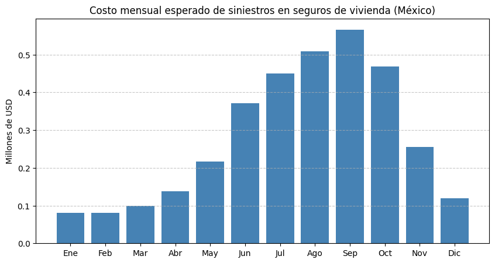

# Implementación Numérica.

## Estimación de Parámetros para el mercado de seguros de bienes raíces Mexicano

### Función de Primas Ajustadas por Inflación: $c(t)$. {#sec-Primas_ajustadas}

::: {style="text-align:justify"}
La prima base para enero de 2024 se establece en $c_0 = 283.00$, derivada del consenso de fuentes sectoriales (AMIS, CNSF). El ajuste por inflación se realiza mediante capitalización compuesta: $$ c(t) = c_0 \prod_{i=1}^{t} \left(1 + \pi_i\right),
 $$ {#eq-ajuste_inflacion} donde $\pi_i$ representa la tasa de inflación mensual reportada por el @inegi2024inpc.
:::

#### Datos de Inflación Mensual

::: {style="text-align:justify"}
La @tbl-inflacion presenta las tasas de inflación utilizadas para el periodo enero 2024 -- diciembre 2025. Los datos de 2024 son observados, mientras que las proyecciones de 2025 se basan en el consenso de analistas del Banco de México @banxico2024expectativas.
:::

|   Mes    | Prima mensual ajustada (MXN) |
|:--------:|:----------------------------:|
| Ene 2024 |            283.00            |
| Feb 2024 |            284.47            |
| Mar 2024 |            285.55            |
| Abr 2024 |            286.72            |
| May 2024 |            288.01            |
| Jun 2024 |            289.42            |
| Jul 2024 |            291.02            |
| Ago 2024 |            292.79            |
| Sep 2024 |            294.49            |
| Oct 2024 |            295.87            |
| Nov 2024 |            297.12            |
| Dic 2024 |            298.28            |
| Ene 2025 |            299.32            |
| Feb 2025 |            300.82            |
| Mar 2025 |            301.93            |
| Abr 2025 |            303.14            |
| May 2025 |            304.47            |
| Jun 2025 |            305.93            |
| Jul 2025 |            307.55            |
| Ago 2025 |            309.37            |
| Sep 2025 |            311.10            |
| Oct 2025 |            312.53            |
| Nov 2025 |            313.81            |
| Dic 2025 |            315.01            |

: Tasas de inflación mensual en México (variación porcentual del INPC Enero 2024- Diciembre 2025). {#tbl-inflacion}

::: {style="text-align:justify"}
Aplicando @eq-ajuste_inflacion, las primas mensuales ajustadas evolucionan de $283.00$ en enero 2024 a $315.01$ en diciembre 2025, representando un incremento acumulado del $11.3\%$, consistente con la inflación proyectada
:::

### Modelado de la tasa de inversión: $r(t)$. {#sec-inversion_mensual}

::: {style="text-align:justify"}
Las aseguradoras mexicanas mantienen carteras conservadoras con asignación aproximada de $70\%$ en instrumentos locales (CETES, Mbonos) y $30\%$ en activos globales ([@cnsf2024panorama]). Siguiendo el marco regulatorio de la CNSF y la estructura conservadora de las carteras aseguradoras mexicanas (informe anual CNSF), modelamos $r(t)$ como combinación convexa ponderada:

$$r(t) = \rho \cdot r_{\text{CETES}}(t) + (1-\rho) \cdot r_{\text{USD}}(t)$$ {#eq-tasa_inversion}

- $\rho = 0.70$,

- $r_{\text{CETES}}(t)$ la tasa de CETES a 28 días mensualizada,

- $r_{\text{USD}}(t)$ el rendimiento de bonos del Tesoro de EE.UU.,

- $\rho = 0.75$ refleja la asignación típica de carteras $(70-80\%)$ en activos locales según CNSF)

Para el periodo 2024-2025, con tasas de Banxico estables en $11.0\%$ anual y bonos USD en $4.8\%$ anual:

$$r(t) = 0.75 \cdot \frac{0.110}{12} + 0.25 \cdot \frac{0.048}{12} = 0.007875 \text{ mensual} \quad (9.45\% \text{ anual})$$

Este valor se ajusta a $0.78\%$ mensual para incorporar costos operativos y fiscales ($1.5$ p.p. anuales), resultando en un rendimiento neto anual de $8.9\%$.
:::

### Modelado de la volatilidad de Inversiones $\sigma(t)$. {#sec-volatilidad_inversiones}

#### Combinación Convexa de Volatilidades

::: {style="text-align:justify"}
La volatilidad total se estima como combinación ponderada de componentes globales y locales:

$$\sigma(t)F = w_g \cdot \sigma_g(t) + w_l \cdot \sigma_l,$$ {#eq-volatilidad}

Los informes anuales de la CNSF sobre la composición de las inversiones del sector asegurador en México indican que, en promedio, las compañías mantienen:

- $30\%$ de sus inversiones en instrumentos del extranjero.

- $70\%$ en instrumentos del mercado nacional.

Dado que no hay datos mensuales oficiales públicos, se asume una asignación constante durante el periodo, basada en el último informe disponible (2023) con $w_g = 0\cdot30$, $w_l = 0\cdot70$.

La componente local $\sigma_l(t)$ respecta a la Volatilidad de CETES a 28 días que es el activo de referencia para las inversiones conservadoras en México, estimada mediante desviación estándar móvil de 30 días de las tasas diarias de Banxico:

$$\sigma_l(t) = 0.05\% \text{ mensual (constante)}$$

Mientras que la componente global $\sigma_g(t)$ es dada por la Volatilidad del índice ILS (Artemis.bm), calculada como desviación estándar móvil de $3$ meses de los rendimientos mensuales. Presenta estacionalidad marcada por la temporada de huracanes (junio-noviembre):

|   Mes    | Volatilidad global $\sigma_g(t)$ |
|:--------:|:--------------------------------:|
| Ene 2024 |              0.08%               |
| Feb 2024 |              0.09%               |
| Mar 2024 |              0.10%               |
| Abr 2024 |              0.11%               |
| May 2024 |              0.12%               |
| Jun 2024 |              0.15%               |
| Jul 2024 |              0.18%               |
| Ago 2024 |              0.35%               |
| Sep 2024 |              0.30%               |
| Oct 2024 |              0.25%               |
| Nov 2024 |              0.20%               |
| Dic 2024 |              0.18%               |
| Ene 2025 |              0.16%               |
| Feb 2025 |              0.14%               |
| Mar 2025 |              0.13%               |
| Abr 2025 |              0.14%               |
| May 2025 |              0.16%               |
| Jun 2025 |              0.20%               |
| Jul 2025 |              0.25%               |
| Ago 2025 |              0.22%               |
| Sep 2025 |              0.28%               |
| Oct 2025 |              0.24%               |
|  Nov-25  |              0.20%               |
| Dic 2025 |              0.18%               |

: Tasas de volatilidad mensual en el mercado global, $\sigma_g(t)$ (Enero 2024- Diciembre 2025).  {#tbl-volatilidad_global}

Los valores están expresados en forma decimal. Por ejemplo, $\sigma (Ene 2024) = 0.059\%=0.00059$ en notación decimal. Por tanto la volatilidad total mensual resultante es:

|   Mes    | $\sigma_g$ | $\sigma_l$ | $\sigma(t)$ |
|:--------:|:----------:|:----------:|:-----------:|
| Ene 2024 |    0.08    |    0.05    |    0.059    |
| Feb 2024 |    0.09    |    0.05    |    0.062    |
| Mar 2024 |    0.10    |    0.05    |    0.065    |
| Abr 2024 |    0.11    |    0.05    |    0.068    |
| May 2024 |    0.12    |    0.05    |    0.071    |
| Jun 2024 |    0.15    |    0.05    |    0.080    |
| Jul 2024 |    0.18    |    0.05    |    0.089    |
| Ago 2024 |    0.35    |    0.05    |    0.140    |
| Sep 2024 |    0.30    |    0.05    |    0.125    |
| Oct 2024 |    0.25    |    0.05    |    0.110    |
| Nov 2024 |    0.20    |    0.05    |    0.095    |
| Dic 2024 |    0.18    |    0.05    |    0.089    |
| Ene 2025 |    0.16    |    0.05    |    0.083    |
| Feb 2025 |    0.14    |    0.05    |    0.077    |
| Mar 2025 |    0.13    |    0.05    |    0.074    |
| Abr 2025 |    0.14    |    0.05    |    0.077    |
| May 2025 |    0.16    |    0.05    |    0.083    |
| Jun 2025 |    0.20    |    0.05    |    0.095    |
| Jul 2025 |    0.25    |    0.05    |    0.110    |
| Ago 2025 |    0.22    |    0.05    |    0.101    |
| Sep 2025 |    0.28    |    0.05    |    0.119    |
| Oct 2025 |    0.24    |    0.05    |    0.107    |
|  Nov-25  |    0.20    |    0.05    |    0.095    |
| Dic 2025 |    0.18    |    0.05    |    0.089    |

: Tasas de volatilidad mensual en el mercado total, $\sigma$ (Enero 2024- Diciembre 2025).  {#tbl-volatilidad_total}

con promedio anual $\bar \sigma= 0.092\%$ con picos superiores a $0.14\%$ en meses de alta actividad catastrófica.
:::

### Función de Costos de Saltos: Eventos Meteorológicos y Sísmicos. {#sec-funcion_costos_met_sis}

::: {style="text-align:justify"}
El proceso de siniestros $S(t)$ se descompone en dos componentes independientes que reflejan la naturaleza bimodal del riesgo en México:

$$S(t) = S_{\text{meteo}}(t) + S_{\text{sismo}}(t) = \sum_{i=1}^{N_{\text{meteo}}(t)} Y_i^{\text{meteo}} + \sum_{j=1}^{N_{\text{sismo}}(t)} Y_j^{\text{sismo}}$$

donde $N_{\text{meteo}}(t)$ sigue un proceso de Poisson no homogéneo con intensidad $\lambda_{\text{meteo}}(t)=\lambda_{\text{meteo}}^{\text{anual}}\cdot\phi(t)$, siendo $\phi(t)$ una función estacional mensual normalizada $\big(\tfrac1{12}\int_0^{12}\phi(s)\ ds=1\big)$, y $N_{\text{sismo}}(t)$ es un proceso de Poisson homogéneo con intensidad constante $\lambda_{\text{sismo}}$, debido a la ausencia de estacionalidad significativa en la ocurrencia de sismos de magnitud relevante para siniestros asegurados. Las severidades $Y$ son i.i.d., independientes de los procesos de conteo y independientes del estado de la reserva.
:::

#### Estimación de la Intensidad de Siniestro.

##### Componente Hidrometeorológico

::: {style="text-align:justify"}
La intensidad mensual $\lambda_{\text{meteo}}(m)$ para el mes $m\in\{1,\dots,12\}$ está dada por

$$\lambda_{\text{meteo}}(m)=\frac{\lambda_{\text{meteo}}^{\text{anual}}}{12}\cdot\phi(m),$$

con $\lambda_{\text{meteo}}^{\text{anual}}=6.0$ eventos/año para fenómenos hidrometeorológicos que generan reclamaciones superiores a USD $100{,}000$ en viviendas aseguradas de la CDMX (registros de CONAGUA @conagua_datos). La función estacional $\phi(m)$ se obtiene normalizando los datos mensuales de frecuencia relativa:

$$\phi(m)=\frac{f_m}{\frac1{12}\sum_{k=1}^{12}f_k},\qquad f=[0.3,0.3,0.4,0.6,1.0,1.8,2.2,2.5,2.8,2.3,1.2,0.5].$$

Esta calibración refleja el pico estacional en septiembre (huracanes y lluvias intensas) y el mínimo en enero–febrero, consistente con el patrón climatológico del centro de México.
:::

::: {.content-visible when-format="pdf"}
{#fig-costo_siniestro fig-pos="H" fig-align="center" width="500" height="335"}
:::

::: {.content-visible when-format="html"}
```{python}
#| label: fig-costo_siniestro
#| fig-cap: Costo mensual esperado de siniestros en seguros de vivienda (México).
import numpy as np
import matplotlib.pyplot as plt
from math import erf, exp, log, sqrt

Phi = lambda x: 0.5 * (1.0 + erf(x / sqrt(2.0)))

# --- Parámetros del modelo  ---
lambda_meteo_annual = 6.0   # eventos/año (hidrometeorológicos, reclamaciones > 100 mil USD)
lambda_sismo = 0.15         # eventos/año (sísmicos con siniestralidad asegurada)

# Severidad meteorológica: lognormal(mu=12.5, sigma=1.0) condicionada a Y > 100,000 USD
mu_m, sig_m, umbral = 12.5, 1.0, 100_000.0
a = (log(umbral) - mu_m) / sig_m
E_Y_meteo = exp(mu_m + 0.5 * sig_m**2) * (1 - Phi(a - sig_m)) / (1 - Phi(a))   # ≈ 515,435 USD

# Severidad sísmica: lognormal con media 1.75M USD y CV = 0.50
E_Y_sismo = 1_750_000.0

# Factor estacional (normalizado)
seasonal_raw = [0.3, 0.3, 0.4, 0.6, 1.0, 1.8, 2.2, 2.5, 2.8, 2.3, 1.2, 0.5]
seasonal_norm = np.array(seasonal_raw) / np.mean(seasonal_raw)

months = ["Ene", "Feb", "Mar", "Abr", "May", "Jun",
          "Jul", "Ago", "Sep", "Oct", "Nov", "Dic"]

# Costo mensual esperado Λ(m)/12 (en USD)
lambda_meteo_m = lambda_meteo_annual / 12 * seasonal_norm
C_t = lambda_meteo_m * E_Y_meteo + (lambda_sismo / 12) * E_Y_sismo
C_t_mill = C_t / 1e6

plt.figure(figsize=(10, 5))
plt.bar(months, C_t_mill, color='steelblue')
plt.title('Costo mensual esperado de siniestros en seguros de vivienda (México)')
plt.ylabel('Millones de USD')
plt.grid(axis='y', linestyle='--', alpha=0.7)
plt.show()

for m, c in zip(months, C_t_mill):
    print(f"{m}: ${c:.2f}M")
print(f"Λ anual esperado: ${C_t_mill.sum():.2f}M")
```
:::

##### Componente Sísmico

::: {style="text-align:justify"}
Para sismos se utiliza $\lambda_{\text{sismo}}=0.15$ eventos/año (un evento cada $\approx6.7$ años), derivado del catálogo del Servicio Sismológico Nacional (SSN @ssn_catalogo) para eventos de magnitud $M_w\ge6.0$ con epicentro a menos de $300$ km de la CDMX que generan siniestralidad asegurada. Dado que la ocurrencia de sismos no presenta estacionalidad estadísticamente significativa ($p$-valor $>0.15$ en la prueba de Kolmogorov–Smirnov de uniformidad mensual), se mantiene intensidad constante:

$$\lambda_{\text{sismo}}(m)=\frac{\lambda_{\text{sismo}}}{12}=0.0125\ \text{eventos/mes}.$$
:::

#### Estimación de la Distribución de Severidad.

::: {style="text-align:justify"}
Las severidades se modelan con distribuciones lognormales: respetan la positividad sin necesidad de truncar, son la familia habitual para montos de siniestro y capturan la cola derecha de las pérdidas catastróficas, a diferencia de una normal truncada (con la misma media y coeficiente de variación, $\mathbb P(Y>5\ \text{millones})$ es $0.70 \%$ bajo la lognormal y $0.01 \%$ bajo una normal truncada).
:::

##### Severidad meteorológica

::: {style="text-align:justify"}
$$\ln Y_{\text{meteo}}\sim\mathcal N(\mu,\sigma^2)\ \text{condicionada a}\ Y_{\text{meteo}}>u,\qquad u=100{,}000\ \text{USD},$$

con $\hat\mu=12.5$ (IC$_{95\%}$: $[12.3,12.7]$) y $\hat\sigma=1.0$ (IC$_{95\%}$: $[0.92,1.08]$), estimados por máxima verosimilitud a partir de las $1{,}247$ reclamaciones hidrometeorológicas del FES 2024 para la CDMX, en escala logarítmica. La condición $Y>u$ es la misma que define los eventos contados por $\lambda_{\text{meteo}}$, de modo que intensidad y severidad describen la misma población de siniestros. Con $\alpha=(\ln u-\mu)/\sigma=-0.987$ y $\Phi$ la función de distribución normal estándar:

$$\mathbb E[Y_{\text{meteo}}]=e^{\mu+\sigma^2/2}\frac{1-\Phi(\alpha-\sigma)}{1-\Phi(\alpha)}\approx\text{USD }515{,}435 .$$

La mediana de la distribución condicionada es de USD $329{,}127$ y $\mathbb P(Y>u)=83.8 \%$ para la lognormal sin condicionar.
:::

##### Severidad sísmica.

::: {style="text-align:justify"}
$$\ln Y_{\text{sismo}}\sim\mathcal N(\mu_s,\sigma_s^2),\qquad \mu_s=\ln(\mathbb E[Y])-\tfrac12\sigma_s^2,\quad\sigma_s=\sqrt{\ln(1+\mathrm{CV}^2)} .$$

Se calibra por ajuste de momentos con media $\mathbb E[Y_{\text{sismo}}]=\text{USD }1{,}750{,}000$ y coeficiente de variación $\mathrm{CV}=0.50$, consistente con la dispersión observada en eventos catastróficos (sismo de 2017: reclamaciones entre USD $0.8$ y $3.2$ millones). Resultan $\mu_s=14.2636$, $\sigma_s=0.4724$, mediana $\text{USD }1{,}565{,}248$ y $\mathbb P(Y>5\ \text{millones})=0.70 \%$.


Con estos parámetros, el costo esperado anual de siniestros es

$$\bar\Lambda=\lambda_{\text{meteo}} \mathbb E[Y_{\text{meteo}}]+\lambda_{\text{sismo}} \mathbb E[Y_{\text{sismo}}]=6.0\times515{,}435+0.15\times1{,}750{,}000\approx\text{USD }3.355\ \text{millones},$$

(USD $3.093$ millones meteorológicos y $0.263$ millones sísmicos), frente a primas medias de USD $4.06$ millones/año: una razón siniestros/prima esperada de $82.6 \%$, de modo que se cumple la condición de ganancia neta $\bar c>\bar\Lambda$. La desviación estándar anual del proceso compensado $\tilde J$ es de $\approx$ USD $2.09$ millones.


## .  {#sec-severidad}
Puesto que los saltos que salen de la reserva son exactamente los siniestros agrgados como se presenta en @sec-funcion_costos_met_sis  se tiene $J_T$ de la siguiente manera:
$$
J_t =  S(t) = S_{\text{meteo}}(t) + S_{\text{sismo}}(t) = \sum_{i=1}^{N_{\text{meteo}}(t)} Y_i^{\text{meteo}} + \sum_{j=1}^{N_{\text{sismo}}(t)} Y_j^{\text{sismo}}, \quad J_0 = 0.
$${#eq-J_t}

donde $N_{\text{meteo}}(t)$ y $N_{\text{sismo}}(t)$ son procesos de conteo de Poisson independientes, con intensidades $\lambda_{\text{meteo}}(t)$ (no homogénea) y $\lambda_{\text{sismo}}$  y ${Y_i^{\text{meteo}}}$, ${Y_j^{\text{sismo}}}$ son sucesiones i.i.d. de severidades, independientes entre sí y de los procesos de conteo, con distribuciones $F_{\text{meteo}}$ y $F_{\text{sismo}}$ respectivamente.

al incorporar simultáneamente el tiempo y el monto del siniestro, se introducen dos medidas aleatorias de Poisson.

Sea

$$
N_{\mathrm{meteo}}(dt,dy)
$$

la medida aleatoria de Poisson asociada a los siniestros meteorológicos y

$$
N_{\mathrm{sismo}}(dt,dy)
$$

la correspondiente a los eventos sísmicos, ambas definidas sobre el espacio de estados
$[0,\infty)\times\mathbb{R}_{+}$.

El costo acumulado de los siniestros meteorológicos hasta el instante $t$ puede escribirse como

$$J_t^{\mathrm{meteo}}
=
\int_0^t
\int_{\mathbb{R}_{+}}
y
N_{\mathrm{meteo}}(ds,dy),
$$

mientras que la componente sísmica viene dada por
$$
J_t^{\mathrm{sismo}}
=
\int_0^t
\int_{\mathbb{R}_{+}}
y
N_{\mathrm{sismo}}(ds,dy).
$$
Suponiendo independencia entre ambas fuentes de riesgo, el proceso agregado de pérdidas se define como
$$
J_t
=
J_t^{\mathrm{meteo}}
+
J_t^{\mathrm{sismo}},
$$
es decir,
$$
\boxed{
J_t
=
\int_0^t
\int_{\mathbb{R}_{+}}
y
N_{\mathrm{meteo}}(ds,dy)
+
\int_0^t
\int_{\mathbb{R}_{+}}
y\,
N_{\mathrm{sismo}}(ds,dy).
}
$$
En forma diferencial,
$$
\boxed{
dJ_t
=
\int_{\mathbb{R}_{+}}
y\,
N_{\mathrm{meteo}}(dt,dy)
+
\int_{\mathbb{R}_{+}}
y\,
N_{\mathrm{sismo}}(dt,dy).
}
$$
Con el fin de separar el componente determinista asociado al costo esperado de los siniestros del componente puramente aleatorio, se introducen las medidas compensadas

$$
\widetilde{N}_{\mathrm{meteo}}(dt,dy)
=
N_{\mathrm{meteo}}(dt,dy)
-
\nu_{\mathrm{meteo}}(t,dy) dt,
$$

y

$$
\widetilde{N}_{\mathrm{sismo}}(dt,dy)
=
N_{\mathrm{sismo}}(dt,dy)
-
\nu_{\mathrm{sismo}}(t,dy) dt.
$$

Sustituyendo estas expresiones en la representación diferencial de $J_t$, se obtiene

$$
\begin{aligned}
dJ_t
={}&
\int_{\mathbb{R}_{+}}
y\,
\widetilde{N}_{\mathrm{meteo}}(dt,dy)
+
\int_{\mathbb{R}_{+}}
y\,
\widetilde{N}_{\mathrm{sismo}}(dt,dy)
\\[1ex]
&
+
\lambda_{\mathrm{meteo}}(t)
\left(
\int_{\mathbb{R}_{+}}
y
F_t^{\mathrm{meteo}}(dy)
\right)dt
\\[1ex]
&
+
\lambda_{\mathrm{sismo}}
\left(
\int_{\mathbb{R}_{+}}
y
F_t^{\mathrm{sismo}}(dy)
\right)dt.
\end{aligned}
$$


## Aproximación numérica del modelo de Crámer Lundberg extendido

Consideramos el proceso de reservas bajo el modelo extendido de Cramér–Lundberg con inversión estocástica y saltos en forma diferencial estocástica compensada:

$$
dX_t=\Big[\underbrace{c(t)+r(t)X_{t^-}-\lambda_{\text{meteo}}(t) \ \mathbb E[Y_{\text{meteo}}]-\lambda_{\text{sismo}} \ \mathbb E[Y_{\text{sismo}}]}_{\mu(t,X_{t^-})}\Big]dt+\underbrace{\sigma(t)X_{t^-}}_{\sigma(t,X_{t^-})} \ dW_t-d\tilde J_t,
$$

donde $\tilde J_t=J_t-\int_0^t\big[\lambda_{\text{meteo}}(s) \ \mathbb E[Y_{\text{meteo}}]+\lambda_{\text{sismo}} \ \mathbb E[Y_{\text{sismo}}]\big]ds$ es el proceso de siniestros agregados compensado (@sec-severidad}}), $d\tilde J_t=\int y \ \tilde N_{\text{meteo}}(dt,dy)+\int y \ \tilde N_{\text{sismo}}(dt,dy)$. Como las severidades son independientes del estado, el valor esperado $\mathbb E[Y]$ son constantes y no condicionales a $\mathcal F_t$.

La compensación separa el costo esperado de los siniestros, 
$$\Lambda(t)=\lambda_{\text{meteo}}(t)\mathbb E[Y_{\text{meteo}}]+\lambda_{\text{sismo}}\mathbb E[Y_{\text{sismo}}],$$

que se carga en la deriva, de su innovación de media cero, $d\tilde J_t$.

Este modelo incorpora parámetros dependientes del tiempo, primas ajustadas por inflación (Sección 8.1.1), tasas de interés estocásticas (Sección 8.1.2), volatilidad mediante combinación convexa (Sección 8.1.3) y un proceso de saltos compuesto que modela siniestros catastróficos meteorológicos y sísmicos con intensidades estacionales (Sección 8.1.4).

Dada la complejidad de la ecuación diferencial estocástica con saltos resultante, cuya solución analítica no es viable ante la no estacionariedad de los parámetros y la estructura de saltos, se requieren métodos numéricos robustos. Para la simulación, se discretiza con paso diario, $\Delta t=1/365$ años, y se consideran dos esquemas numéricos.

## Implementación Numérica Métodos Milstein y Semi-Implícito.

Presentando el algoritmo de Milstein compensado (@sec-Milstein_compensado), escrito en lenguaje natural estructurado (es decir, como un pseudocódigo), diseñado específicamente para aproximar soluciones de ecuaciones diferenciales estocásticas (EDS) con difusión y salto ( @eq-reservas-8-5), como las que surgen en el modelo de Cramér–Lundberg (@eq-modelo_extendido) por ejemplo, con componentes de procesos compuestos de Poisson)

El pseudocódigo siguiente está pensado para ser puente conceptual entre la teoría y la implementación, y se enfoca en la versión compensada (es decir, usando el proceso de salto compensado (@def-med_alea_poisson) $\tilde{N} = N_t - \lambda t$) para garantizar que el término de salto tenga esperanza cero y sea adecuado para esquemas numéricos estables.
:::

### Pseudocódigo: Esquema de Milstein Compensado para EDE con Difusión y Salto.

::: {#alg-milstein-entrada}
**Algoritmo 1:** Datos de Entrada - Simulación de Reservas Cramér-Lundberg con Método de Milstein Compensado
:::

| Tipo | Parámetro | Descripción |
|:-----------------------|:-----------------------|:-----------------------|
| Entrada | $U_0^{\text{hist}}$ | Capital inicial histórico (USD) |
|  | $T_{\text{hist}}$, $T_{\text{fc}}$ | Horizonte histórico (años) y de pronóstico (días) |
|  | $\Delta t$ | Paso de tiempo, $1/365$ años |
|  | $M_{\text{hist}}$, $M_{\text{fc}}$ | Número de trayectorias Monte Carlo |
|  | Semillas | $s_{\text{hist}}=2026$, $s_{\text{fc}}=2027$ |
|  | $c_{\text{mens}}[k], r_{\text{mens}}[k], \sigma_{\text{mens}}[k]$ | Parámetros mensuales, $k=0,\dots,23$ (Secciones 8.1.1–8.1.3) |
|  | $\lambda_{\text{meteo}},\ \phi[\cdot]$ | Intensidad anual meteorológica ($6.0$) y factor estacional normalizado |
|  | $\lambda_{\text{sismo}}$ | Intensidad anual sísmica ($0.15$) |
|  | $F_{\text{meteo}}$ | Lognormal$(\mu=12.5,\sigma=1.0)$ condicionada a $Y>100{,}000$ |
|  | $F_{\text{sismo}}$ | Lognormal$(\mu_s=14.2636,\sigma_s=0.4724)$ (media $1.75$ M, CV $0.50$) |
| Derivados | $E_{\text{meteo}},E_{\text{sismo}}$ | Medias exactas de $F$ (fórmula cerrada, verificadas por Monte Carlo) |
| Salida | $\text{mediana}_{\text{hist}},\ IC^{\text{hist}}_{5,95}$ | Estadísticas del periodo histórico |
|  | $\text{mediana}_{\text{fc}},\ IC^{\text{fc}}_{5,95}$ | Estadísticas del pronóstico |
|  | $\text{saltos}_{\text{hist}},\ \text{saltos}_{\text{fc}}$ | Días marcados en la mediana |
|  | $J_m,\ J_s$ | Siniestros brutos por paso (para diagnóstico y estimación) |


::: {#alg-fase1}
**Algoritmo 2:** Fase 1, simulación histórica y pronóstico
con Milstein compensado.
:::

``` python
#| label: alg-fase1-code
#| eval: false
# ---- Preprocesamiento (parámetros anualizados e interpolados) ----
N_hist ← ⌊T_hist / Δt⌋                              # 730 pasos diarios
para i ← 0 hasta N_hist - 1:
    t_mes[i]    ← i · 12 · Δt                       # mes continuo, 0..24
    mes[i]      ← ⌊t_mes[i]⌋ mod 12
    c_hist[i]   ← 12 · interp(t_mes[i]; c_mens)      # USD/año
    r_hist[i]   ← 12 · interp(t_mes[i]; r_mens)      # 1/año
    sigma_hist[i] ← √12 · interp(t_mes[i]; sigma_mens)
    lam_m[i]    ← lambda_meteo · phi[mes[i]]         # eventos/año
    Lambda[i]   ← lam_m[i] · E_meteo + lambda_sismo · E_sismo   # USD/año

# ---- Severidades (independientes del estado) ----
función MuestrearSeveridad(F, k):        # k variables i.i.d. ~ F
    mientras queden pendientes:
        Z ← Normal(0, 1)
        Y ← exp(mu_F + sigma_F · Z)
        aceptar Y si Y > umbral_F            # rechazo (umbral_sismo = 0)

función SumaSeveridades(F, n_ev[1..M]):
# suma de n_ev[m] severidades por trayectoria
    devolver (suma de MuestrearSeveridad(F, n_ev[m]) para cada m)

# -- Fase 1: simulación histórica (M_hist trayectorias en paralelo) --
Inicializar X[M_hist][N_hist + 1] ← 0
X[m][0] ← U0_hist    para todo m

para i ← 0 hasta N_hist - 1:
    n_m ← Poisson(lam_m[i] · Δt)             # vectores de tamaño M_hist
    n_s ← Poisson(lambda_sismo · Δt)
    Jm[·][i] ← SumaSeveridades(F_meteo, n_m)
    Js[·][i] ← SumaSeveridades(F_sismo, n_s)
    dJ_tilde ← Jm[·][i] + Js[·][i] - Lambda[i] · Δt      
    # incremento COMPENSADO (media cero)

    ΔW ← √Δt · Normal(0, 1)
    drift ← (c_hist[i] + r_hist[i] · X[·][i] - Lambda[i]) · Δt
    diff  ← sigma_hist[i] · X[·][i] · ΔW
    corr  ← (1/2) · sigma_hist[i]² · X[·][i] · (ΔW² - Δt)
    X[·][i + 1] ← X[·][i] + drift + diff + corr - dJ_tilde

# ---- Estadísticas históricas ----
para i ← 0 hasta N_hist:
    median_hist[i] ← Mediana(X[·][i])
    IC_hist[i]     ← [Percentil_5(X[·][i]), Percentil_95(X[·][i])]

U0_fc ← Mediana(X[·][N_hist])

# ---- Fase 2: pronóstico (enero 2026, T_fc = 30 pasos) ----
c_ene     ← 12 · (c_mens[0] + c_mens[12]) / 2
r_ene     ← 12 · (r_mens[0] + r_mens[12]) / 2
sigma_ene ← √12 · (sigma_mens[0] + sigma_mens[12]) / 2
lam_m_ene ← lambda_meteo · phi[enero]
Lambda_ene ← lam_m_ene · E_meteo + lambda_sismo · E_sismo
# (estructura idéntica a la Fase 1 con parámetros constantes de enero 
# y condición inicial U0_fc)
U[m][i + 1] ← U[m][i] + (c_ene + r_ene · U[m][i] - Lambda_ene) · Δt
               + sigma_ene · U[m][i] · ΔW + (1/2) · sigma_ene² · U[m][i] · (ΔW² - Δt) - dJ_tilde

# ---- Diagnóstico de la compensación ----
dJt ← Jm + Js - Lambda · Δt
verificar |media(dJt)| < 3 · EE(dJt)          
# E[ΔJ~] = 0 (histórico y pronóstico)

# ---- Detección de saltos en la mediana ----
log_ret_hist ← ln(median_hist[1:] / median_hist[:-1])
tau_hist ← 3 · DesvEst(log_ret_hist)
saltos_hist ← {(t_i, median_hist[i]) | |log_ret_hist[i-1]| > tau_hist}
# (mismo procedimiento para median_fc)

guardar X, U_forecast, c_hist, r_hist, sigma_hist, Jm, Js en archivo .npz
retornar median_hist, IC_hist, median_fc, IC_fc, saltos_hist, saltos_fc
```

### Pseudocódigo: Esquema Semi-Implícito Compensado para EDE con Difusión y Salto

::: {#alg-semi-implícito}
**Algoritmo 3:** Simulación de Reservas Cramér-Lundberg con Método Semi-Implícito Compensado
:::

| Tipo | Parámetro | Descripción |
|:-----------------------|:-----------------------|:-----------------------|
| Entrada | $U_0$ | Capital inicial (USD) |
|  | $T$, $\Delta t$ | Horizonte (años) y paso de tiempo ($1/365$ para diario) |
|  | $M$ | Número de trayectorias Monte Carlo |
|  | $c(t), r(t), \sigma(t)$ | Funciones temporales: prima ajustada, tasa de inversión y volatilidad (mensuales, anualizadas e interpoladas) |
|  | $\lambda_{\text{meteo}}(t)=\lambda_{\text{meteo}} \phi(t)$ | Intensidad estacional meteorológica ($\lambda_{\text{meteo}}=6.0$ eventos/año) |
|  | $\lambda_{\text{sismo}}$ | Intensidad constante sísmica ($0.15$ eventos/año) |
|  | $F_{\text{meteo}}, F_{\text{sismo}}$ | Severidades lognormales (como en el Algoritmo 1) |
| Verificación | (H3) | $\max_i r(t_i) \Delta t<1/2$ (el programa se detiene si no se cumple) |
| Salida | $U[M][N+1]$ | Trayectorias simuladas de reservas |
|  | $\tilde U[N+1]$ | Pronóstico robusto mediante la mediana |
|  | $IC_{5,95}[N+1]$ | Intervalo de confianza al 90 % |

::: {#alg-semi-fase1}
**Algoritmo 4:** Fase 1 - preprocesamiento de parámetros y
simulación semi-implícita compensada
:::

``` python
#| label: alg-semi-fase1-code
#| eval: false
# ---- Preprocesamiento de parámetros temporales ----
para i ← 0 hasta N - 1:
    t_mes[i] ← i · 12 · Δt;   mes[i] ← ⌊t_mes[i]⌋ mod 12
    c_i[i]   ← 12 · interp(t_mes[i]; c_mens)# prima ajustada por inflación
    r_i[i]   ← 12 · interp(t_mes[i]; r_mens) # rendimiento de inversión
    sigma_i[i] ← √12 · interp(t_mes[i]; sigma_mens)  # volatilidad
    lam_m[i] ← lambda_meteo · phi[mes[i]]            # eventos/año
    Lambda[i] ← lam_m[i] · E_meteo + lambda_sismo · E_sismo  # USD/año

# ---- Verificación de la hipótesis (H3) ----
si máx(r_i) · Δt ≥ 1/2 entonces: DETENER con error  

Inicializar U[M][N + 1] ← 0;   U[·][0] ← U_0

para i ← 0 hasta N - 1:
    # 2.1 Generación exacta de saltos brutos (independientes del estado)
    n_m ← Poisson(lam_m[i] · Δt);   n_s ← Poisson(lambda_sismo · Δt)
    Jm ← SumaSeveridades(F_meteo, n_m);   Js ← SumaSeveridades(F_sismo, n_s)

    # 2.2 Incremento compensado (media cero)
    dJ_tilde ← Jm + Js - Lambda[i] · Δt

    # 2.3 Actualización semi-implícita (r tratado implícitamente)
    ΔW ← √Δt · Normal(0, 1)
    numerador   ← U[·][i] · (1 + sigma_i[i] · ΔW) 
    + (c_i[i] - Lambda[i]) · Δt - dJ_tilde
    denominador ← 1 - r_i[i] · Δt    # ≥ 1/2 por (H3)
    U[·][i + 1] ← numerador / denominador

# ---- Estadísticas ----
para i ← 0 hasta N:
    U_med[i] ← Mediana(U[·][i])
    IC[i]    ← [Percentil_5(U[·][i]), Percentil_95(U[·][i])]

# ---- Diagnóstico de la compensación ----
verificar |media(Jm + Js - Lambda · Δt)| < 3 · EE         # E[ΔJ~] = 0

# ---- FASE 4: detección de saltos en la trayectoria mediana ----
log_ret[i] ← ln(U_med[i] / U_med[i - 1])    para i ← 1 hasta N
tau ← 3 · DesvEst(log_ret)
saltos ← {(t_i, U_med[i]) | |log_ret[i]| > tau}

guardar U, U_forecast, c_i, r_i, sigma_i, Jm, Js en archivo .npz
retornar U_med, IC, saltos
```