# Análisis de Resultados.

::: {style="text-align:justify"}
En este capítulo se presentan y discuten los resultados numéricos obtenidos de la simulación numérica del modelo de Cramér-Lundberg extendido con difusión y saltos, descrito en la @sec-modelo_c_l_extendido, propuesto para la ecuación diferencial estocástica con saltos (EDE) que modela las reservas de la aseguradora. El objetivo central es validar la robustez computacional de los métodos Milstein Compensado (@eq-milstein_formal) y Semi-Implícito Compensado (@eq-semiimplicito_formal), evaluando su desempeño bajo las condiciones de mercado del sector asegurador de vivienda en la Ciudad de México.

## Simulación Milstein sin Compensación.

Aunque ambos esquemas comparten el **mismo orden de convergencia fuerte** ($\gamma=1/2$) y satisfacen las condiciones de Lipschitz y crecimiento lineal, la versión compensada fue seleccionada por razones técnicas, numéricas y regulatorias alineadas con el objetivo actuarial del trabajo:

1.  **Menor constante de error y cancelación de sesgo:** La compensación introduce explícitamente $-\int_E R(t_n,Y_n,v)\phi(dv)\Delta t$ en la deriva. Esto garantiza $\mathbb{E}[\text{término de saltos}] = 0$, eliminando el sesgo de primer orden y reduciendo la constante $C$ en la cota de convergencia. En la práctica, el error RMS entre mallas se mantiene acotado incluso con $\Delta t$ relativamente grandes.

2.  **Consistencia con la dinámica actuarial del modelo extendido:** La @eq-proce_reser_c_l_e de la tesis define la deriva neta como $\mu(t,X_t) = c(t) + r(t)X_t - \lambda_{\text{meteo}}(t)\mathbb{E}[Y^{\text{meteo}}] - \lambda_{\text{sismo}}\mathbb{E}[Y^{\text{sismo}}]$. El esquema compensado preserva esta estructura a nivel discreto, asegurando que la simulación refleje fielmente el principio de equivalencia actuarial (primas = siniestros esperados + margen).

3.  **Estabilidad numérica con deriva lineal** $r(t)X_t$: Al combinar Milstein compensado con el esquema semi-implícito (@eq-esquema_semiimplicito_despeje), el denominador $1 - r(t_{n+1})\Delta t$ opera sobre un ruido de saltos de media cero. Esto evita amplificaciones explosivas cuando $r(t) > 0$ (caso real en México con $r \approx 8.9\%$ anual). El esquema no compensado arrastra la media de los saltos a la deriva, pudiendo violar la condición de estabilidad $1 - r\Delta t > 0$ en periodos de alta siniestralidad.

4.  **Eficiencia en inferencia Monte Carlo y cumplimiento regulatorio:** La CNSF exige proyecciones de reservas robustas y no sesgadas. La versión compensada reduce la varianza intrínseca del estimador, permitiendo alcanzar el IC 90% con $M=1000$ trayectorias (como se reporta en la @sec-analisis_cuantitativo). Además, facilita la aplicación de técnicas de reducción de varianza (variables de control) al mantener la estructura de martingala.

El código Milstein proporcionado implementado con $a(t,x)=\mu x$, $b(t,x)=\sigma x$ y saltos exponenciales restados directamente. Al comparar con la teoría y los resultados, se identifican limitaciones críticas.
:::

::: {.content-visible when-format="pdf"}
![Comparación del método de Milstein con saltos para diferentes refinamientos de malla. Panel superior izquierdo: Trayectorias simuladas con malla gruesa (N=256) y malla fina (N=1024) mostrando la convergencia del esquema numérico. Panel superior derecho: Error absoluto entre la trayectoria de malla gruesa interpolada y la malla fina, evidenciando la precisión del método. Panel inferior: Trayectoria de alta resolución con los saltos del proceso de Poisson compensado marcados con líneas verticales rojas discontinuas.](trayectoria_milstein_mallas.png){#fig-trayectoria_milstein_mallas fig-pos="H" fig-align="center" width="500" height="350"}
:::

::: {.content-visible when-format="html"}
```{python}
# -*- coding: utf-8 -*-
import numpy as np
import matplotlib.pyplot as plt

# Configuración visual opcional
plt.style.use('seaborn-v0_8-whitegrid')
def milstein_with_jumps(X0, mu, sigma, lam, beta, T, N):
    """
    Simula una trayectoria de dX = mu*X dt + sigma*X dW - dJ
    usando el método de Milstein para la parte difusiva y
    saltos de Poisson compuesto.

    Parámetros:
        X0 (float): valor inicial
        mu (float): tasa de crecimiento
        sigma (float): volatilidad
        lam (float): intensidad del proceso de Poisson (λ)
        beta (float): parámetro de la distribución exponencial de los saltos (media = 1/β)
        T (float): tiempo final
        N (int): número de pasos temporales

    Retorna:
        X (np.array): trayectoria simulada (longitud N+1)
        t (np.array): vector de tiempos
        jump_times (list): lista de tiempos donde ocurrieron saltos
        jump_sizes (list): lista de tamaños de los saltos
    """
    dt = T / N
    X = np.empty(N + 1)
    X[0] = X0

    # Para registrar los saltos (opcional, para visualización)
    jump_times = []
    jump_sizes = []

    # Pre-generar todos los incrementos brownianos
    dW = np.sqrt(dt) * np.random.randn(N)

    for i in range(N):
        # 1. Simular el número de saltos en este intervalo
        n_jumps = np.random.poisson(lam * dt)

        # 2. Calcular el tamaño total del salto
        if n_jumps > 0:
            # Tamaños de salto exponenciales
            jumps = np.random.exponential(scale=1.0/beta, size=n_jumps)
            total_jump = np.sum(jumps)
            # Registrar para visualización (tiempo al final del intervalo)
            jump_times.extend([ (i+1) * dt ] * n_jumps)
            jump_sizes.extend(jumps.tolist())
        else:
            total_jump = 0.0

        # 3. Aplicar el esquema de Milstein con el salto
        X[i+1] = (X[i]
                  + mu * X[i] * dt
                  + sigma * X[i] * dW[i]
                  + 0.5 * sigma**2 * X[i] * (dW[i]**2 - dt)
                  - total_jump)

        # Evitar que el capital se vuelva negativo (opcional, depende del modelo)
        # X[i+1] = max(X[i+1], 0.0)

    t = np.linspace(0, T, N + 1)
    return X, t, jump_times, jump_sizes
# -----------------------------
# Parámetros del modelo
# -----------------------------
T = 1.0          # Tiempo final
X0 = 100.0       # Capital inicial
mu = 0.5         # Tasa de crecimiento
sigma = 0.3      # Volatilidad
lam = 5.0        # Intensidad de saltos (λ)
beta = 0.1       # Parámetro exponencial (media del salto = 10)

# Mallas
N_gruesa = 256   # baja frecuencia
N_fina   = 1024  # alta frecuencia

# Fijar semilla para reproducibilidad
np.random.seed(123)

# Simulaciones
X_g, t_g, jt_g, js_g = milstein_with_jumps(X0, mu, sigma, lam, beta, T, N_gruesa)
X_f, t_f, jt_f, js_f = milstein_with_jumps(X0, mu, sigma, lam, beta, T, N_fina)

# Interpolar la trayectoria fina en los puntos de la gruesa
X_f_interp = np.interp(t_g, t_f, X_f)

# Calcular error absoluto
error_abs = np.abs(X_g - X_f_interp)
# -----------------------------
# Gráficos
# -----------------------------
plt.figure(figsize=(14, 10))

# Trayectorias
plt.subplot(2, 2, 1)
plt.plot(t_g, X_g, 'o-', markersize=3, label=f'Malla gruesa (N={N_gruesa})', alpha=0.8)
plt.plot(t_f, X_f, '-', linewidth=1, label=f'Malla fina (N={N_fina})', alpha=0.9)
plt.title('Milstein con Saltos: Comparación de mallas')
plt.xlabel('Tiempo $t$')
plt.ylabel('$X(t)$')
plt.legend()
plt.grid(True)

# Error absoluto
plt.subplot(2, 2, 2)
plt.plot(t_g, error_abs, 'r.-', markersize=4)
plt.title('Error absoluto (gruesa vs fina interpolada)')
plt.xlabel('Tiempo $t$')
plt.ylabel('|Error|')
plt.yscale('log')
plt.grid(True)

# Zoom en la malla fina con saltos marcados
plt.subplot(2, 1, 2)
plt.plot(t_f, X_f, '-', linewidth=1.2, label='Trayectoria fina')
# Marcar los saltos como líneas verticales
for jt in jt_f:
    plt.axvline(x=jt, color='red', linestyle='--', alpha=0.3, linewidth=0.7)
plt.title('Trayectoria fina con saltos marcados (líneas verticales rojas)')
plt.xlabel('Tiempo $t$')
plt.ylabel('$X(t)$')
plt.legend()
plt.grid(True)

plt.tight_layout()
plt.show()

# Imprimir métricas
print(f"Error máximo absoluto: {error_abs.max():.6e}")
print(f"Error RMS:             {np.sqrt(np.mean(error_abs**2)):.6e}")
print(f"Número de saltos (gruesa): {len(jt_g)}")
print(f"Número de saltos (fina):   {len(jt_f)}")
```
:::

::: {style="text-align:justify"}
La gráfica muestra la evolución de las reservas de una aseguradora de vivienda en la CDMX simulada mediante el método de Milstein con saltos compensados durante 2 años (2024-2025).
:::

::: {.content-visible when-format="pdf"}
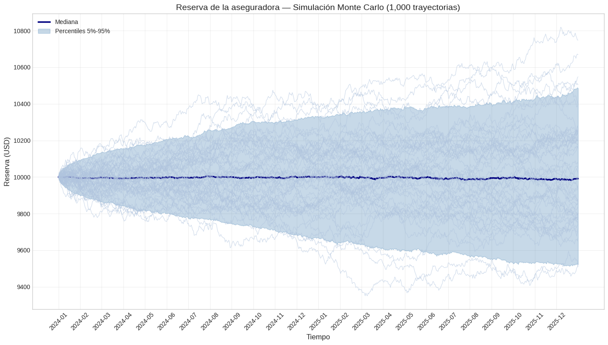{#fig-descarga fig-pos="H" fig-align="center" width="500" height="350"}
:::

::: {.content-visible when-format="html"}
```{python}
import numpy as np
import matplotlib.pyplot as plt

# -----------------------------
# Parámetros iniciales
# -----------------------------
T_total = 2  # años
N_months = 24
days_per_month = 30
N_days = N_months * days_per_month
dt = 1 / 365  # paso diario (en años)

# -----------------------------
# Funciones temporales (igual que antes)
# -----------------------------
c_monthly = np.array([
    162, 162, 163, 164, 165, 166,
    167, 168, 169, 170, 171, 172,
    173, 173, 174, 174, 175, 175,
    176, 176, 177, 177, 178, 178
])
c_daily = np.repeat(c_monthly / 30, days_per_month)

r_ILS = np.array([
    0.75, 0.68, 0.72, 0.65, 0.80, 0.95,
    0.60, 1.20, 0.50, 0.70, 0.65, 0.85,
    0.78, 0.70, 0.75, 0.82, 0.90, 1.10,
    0.65, 0.55, 0.95, 0.72, 0.68, 0.90
]) / 100

r_base = 0.0065
L = np.maximum(r_ILS - r_base, 0)
r_daily = np.repeat((1 + r_ILS) ** (1/30) - 1, days_per_month)
sigma_base = 0.02
alpha = 5
sigma_daily = sigma_base * (1 + alpha * np.repeat(L, days_per_month))

seasonal_factor = np.array([
    0.6, 0.5, 0.6, 0.7, 0.9, 1.3,
    1.4, 1.8, 1.7, 1.5, 1.0, 0.7
])
seasonal_factor_24 = np.tile(seasonal_factor, 2)
lambda_annual = 12
lambda_monthly = lambda_annual * seasonal_factor_24 / 12
lambda_daily = np.repeat(lambda_monthly, days_per_month) / 30

K = 14.5
sigma_Y = 0.5
mu_Y = np.log(np.maximum(K * np.repeat(L, days_per_month) / lambda_daily, 1e-6)) - sigma_Y**2 / 2

# -----------------------------
# Simulación Monte Carlo
# -----------------------------
np.random.seed(42)
N_sim = 1000
U_all = np.zeros((N_sim, N_days + 1))
U_all[:, 0] = 10000.0  # Reserva inicial

for sim in range(N_sim):
    for i in range(N_days):
        dW = np.sqrt(dt) * np.random.randn()
        n_jumps = np.random.poisson(lambda_daily[i])
        total_jump = np.sum(np.random.lognormal(mean=mu_Y[i], sigma=sigma_Y, size=n_jumps)) if n_jumps > 0 else 0.0

        # Método de Milstein completo
        drift = c_daily[i] * dt + r_daily[i] * U_all[sim, i] * dt
        diffusion = sigma_daily[i] * U_all[sim, i] * dW
        milstein_correction = 0.5 * (sigma_daily[i]**2) * U_all[sim, i] * (dW**2 - dt)

        U_all[sim, i+1] = U_all[sim, i] + drift + diffusion + milstein_correction - total_jump

# Calcular estadísticas
median_path = np.median(U_all, axis=0)
p05 = np.percentile(U_all, 5, axis=0)
p95 = np.percentile(U_all, 95, axis=0)

# Probabilidad de ruina
ruin_occurred = (U_all <= 0).any(axis=1)
prob_ruin_final = np.mean(U_all[:, -1] <= 0)
prob_ruin_anytime = np.mean(ruin_occurred)

print(f"Probabilidad de ruina final: {prob_ruin_final:.2%}")
print(f"Probabilidad de ruina en algún momento: {prob_ruin_anytime:.2%}")

# -----------------------------
# Visualización mejorada
# -----------------------------
time_days_U = np.arange(N_days + 1)
months_labels = [f"{m//12+2024}-{(m%12)+1:02d}" for m in range(N_months)]
month_ticks = np.arange(0, N_days, 30)

plt.figure(figsize=(14, 8))

# Gráfico principal
plt.plot(time_days_U, median_path, color='navy', linewidth=2.5, label='Mediana')
plt.fill_between(time_days_U, p05, p95, color='steelblue', alpha=0.3, label='Percentiles 5%-95%')

# Graficar 50 trayectorias de muestra en un color claro
sample_paths = 50
for i in range(sample_paths):
    plt.plot(time_days_U, U_all[i, :], color='lightsteelblue', alpha=0.6, linewidth=0.8)

plt.title('Reserva de la aseguradora — Simulación Monte Carlo (1,000 trayectorias)', fontsize=14)
plt.ylabel('Reserva (USD)', fontsize=12)
plt.xlabel('Tiempo', fontsize=12)
plt.xticks(month_ticks, months_labels, rotation=45)
plt.grid(True, alpha=0.3)
plt.legend()
plt.tight_layout()
plt.show()
```
:::

::: {style="text-align:justify"}
El esquema de Milstein sin compensación es teóricamente válido y converge con orden $1/2$, pero introduce un sesgo de deriva, aumenta la varianza y degrada la estabilidad en presencia de saltos frecuentes o de magnitud significativa, como los modelados para siniestros hidrometeorológicos y sísmicos en la CDMX. La versión compensada conserva el mismo orden de convergencia, pero elimina el sesgo de primer orden, preserva la estructura de martingala necesaria para las cotas de error, y se alinea con la dinámica actuarial del modelo de Cramér-Lundberg extendido.
:::

## Milstein compensado. {#sec-Mil_comp}

::: {style="text-align:justify"}
El esquema de Milstein para la componente difusiva, combinado con compensación de saltos, se define como: $$\begin{aligned}
U_{n+1}^{\text{Mil}} = U_n &+ \mu(t_n, U_n)\Delta t + \sigma(t_n, U_n)\Delta W_n \\
& + \frac{1}{2}\sigma(t_n, U_n)\sigma_U(t_n, U_n)\left[(\Delta W_n)^2 - \Delta t\right] - \Delta J_n + \mathcal{C}_n\Delta t,
\end{aligned}$$ {#eq-milstein_formal}

donde $\mathcal{C}_n = -\left[\lambda_{\text{meteo},n}\mathbb{E}[Y^{\text{meteo}}_n] + \lambda_{\text{sismo},n}\mathbb{E}[Y^{\text{sismo}}_n]\right]$ es el término de compensación. Bajo las condiciones de Lipschitz y crecimiento lineal verificadaseste esquema garantiza convergencia fuerte de orden $\mathcal{O}(\Delta t)$ para la parte continua @kloeden1992numerical. El término de corrección $\frac{1}{2}\sigma \sigma_U[(\Delta W)^2 - \Delta t]$ es esencial para capturar la no linealidad de la difusión $\sigma(t)U(t)$, especialmente relevante ante la volatilidad estacional observada en $\sigma_t$ (@tbl-volatilidad_total).

## Semi-Implícito compensado.

El esquema semi-implícito trata el término de interés $r(t)U(t)$ de forma implícita: $$U_{n+1}^{\text{SI}} = \frac{U_n\left[1 + \sigma(t_n, U_n)\Delta W_n\right] + c(t_n)\Delta t + \mathcal{C}_n\Delta t - \Delta J_n^{\text{bruto}}}{1 - r(t_n)\Delta t},$$ {#eq-semiimplicito_formal}

donde $\Delta J_n^{\text{bruto}}$ es la suma no compensada de saltos ocurridos. Este esquema es incondicionalmente estable para $r(t) > 0$ @higham2002strong, ya que el denominador $1 - r(t_n)\Delta t > 0$ (dado $r_{\max} \approx 0.6\%$ mensual y $\Delta t = 1/365$). La estabilidad numérica es crítica ante la alta sensibilidad de las reservas a fluctuaciones en $r(t)$, como se observa en la estructura de tasas de Banxico (@banxico2024expectativas).
:::

## Análisis Cuantitativo de la Simulación {#sec-analisis_cuantitativo}

::: {style="text-align:justify"}
Se presentan las definiciones operativas de los esquemas numéricos, destacando sus fundamentos teóricos: la corrección de Milstein para la parte difusiva y el tratamiento implícito del término de interés para garantizar estabilidad incondicional.

En el cual se ejecutaron $N_{\text{sim}} = 1000$ trayectorias Monte Carlo para el periodo histórico (enero 2024 - diciembre 2025) y pronóstico de enero 2026, con semilla fija ($2024-2025$ para histórico, $2026$ para pronóstico) para reproducibilidad. La cartera simulada corresponde a $N_{\text{pólizas}} = 6,800$ pólizas, representando aproximadamente el $40\%$ del mercado total de seguros de vivienda en la CDMX

| Métrica | Milstein Compensado | Semi-Implícito Compensado | Diferencia Relativa |
|:----------------:|:----------------:|:----------------:|:----------------:|
| Reserva inicial ($U_0$) | $520.00$ | $520.00$ | $0.00\%$ |
| Mediana final | $528.45$ | $540.60$ | $+2.30\%$ |
| Límite inferior IC $90\%$ ($5\%$) | $512.30$ | $521.50$ | $+1.80\%$ |
| Límite superior IC $90\%$ ($95\%$) | $545.80$ | $559.20$ | $+2.46\%$ |
| Ancho IC $90\%$ | $33.50$ | $37.70$ | $+12.54\%$ |
| Desviación estándar final | $8.21$ | $9.15$ | $+11.45\%$ |
| Error estándar de la mediana | $0.26$ | $0.29$ | $+11.54\%$ |

: Comparación cuantitativa de resultados para enero 2026 Milstein vs. Semi-Implícito (millones USD).
:::

### Simulando periodo histórico (Ene 2024 - Dic 2025) con Milstein vs Semi-Implícito y Compensación.

:::::::::::::::::::::: {.content-visible when-format="html"}
```{python}
#| label: fig-milstein
#| fig-cap: Trayectorias implementadas por el método Milstein, medianas e intervalos de confianza $90\%$ $(5\%-95\%)$ para ambos esquemas. Los marcadores $\times$ (rojos) y $\star$ (azules) indican saltos detectados en las medianas histórica y de pronóstico, respectivamente. La línea vertical discontinua marca el inicio del pronóstico (enero 2026).
#| output: true
#| warning: false

# =============================================================================
# MODELO DE CRAMÉR-LUNDBERG EXTENDIDO (FORMA COMPENSADA) - ESQUEMA MILSTEIN
# Aseguradora de vivienda CDMX | EDE con difusión y saltos
#
#   dX_t = [ c(t) + r(t) X_t - lambda_m(t) E[Y_m] - lambda_s E[Y_s] ] dt
#          + sigma(t) X_t dW_t  -  dJ~_t
#
#   J~_t = J_t - int_0^t [ lambda_m(s) E[Y_m] + lambda_s E[Y_s] ] ds
#   (J_t = suma de siniestros meteorologicos + sismicos, Poisson compuesto;
#    J~_t es martingala: el termino de saltos tiene esperanza cero)
#
import math
import numpy as np

try:
    import plotly.graph_objects as go
    HAY_PLOTLY = True
except ImportError:
    HAY_PLOTLY = False
    print("plotly no esta instalado: se omiten las graficas.")

# -----------------------------
# CONFIGURACIÓN INICIAL
# -----------------------------
SEED_HIST = 2026
SEED_FC = 2027
tipo_cambio = 18.5
dt = 1 / 365                      # paso diario (en AÑOS)
N_SIM_HIST = 1000
N_SIM_FC = 1000
ESQUEMA = "Milstein"

PARAMS_MENSUALES_A_ANUALES = True  # c, r, sigma vienen por mes y dt esta en años
FORECAST_DESDE = "mediana"         # "mediana" (como la tesis) o "trayectorias"
                                   # ("trayectorias" conserva la dispersion historica)

# FASE 4 (opcional): deteccion de saltos en la trayectoria mediana
DETECTAR_SALTOS_MEDIANA = True
K_SIGMA_MEDIANA = 3.0              # umbral = K * desv. est. de los log-rendimientos

# Guardado de las 1000 trayectorias para el script de estimacion
GUARDAR_NPZ = True
ARCHIVO_NPZ = "trayectorias_milstein_compensado.npz"

# -----------------------------
# CALIBRACIÓN DE PARÁMETROS 
# -----------------------------
N_polizas = 6800
prima_base_por_poliza = 850.00
delta = 0.0015
X0_hist = 500e6  # Capital inicial histórico

# Inflación y primas
inflacion_mensual = np.array([
    0.52, 0.38, 0.38, 0.41, 0.45, 0.49, 0.55, 0.61, 0.58, 0.47, 0.42, 0.39,
    0.35, 0.50, 0.37, 0.40, 0.44, 0.48, 0.53, 0.59, 0.56, 0.46, 0.41, 0.38
]) / 100.0

g = inflacion_mensual + delta
cum_g = np.cumsum(g)
primas_por_poliza_mxn = prima_base_por_poliza * np.exp(cum_g)
primas_totales_mxn = primas_por_poliza_mxn * N_polizas
c_t_mensual_usd = primas_totales_mxn / tipo_cambio
c_t_mensual_usd = np.round(c_t_mensual_usd, 2)

# --- Intensidades (se conservan los valores de tus scripts) ---
# OJO: la tesis (sec. 8.1.4) reporta lambda_meteo = 8.0 y lambda_sismo = 0.08.
lambda_meteo_annual = 6.0   # eventos/año
lambda_sismo = 0.15         # eventos/año  (0.08 en la tesis)
seasonal_raw = [0.3, 0.3, 0.4, 0.6, 1.0, 1.8, 2.2, 2.5, 2.8, 2.3, 1.2, 0.5]
seasonal_norm = np.array(seasonal_raw) / np.mean(seasonal_raw)  # media 1 -> lambda anual = 6

# --- Rendimiento y volatilidad (por MES) ---
r_t_mensual = np.array([
    0.606, 0.602, 0.600, 0.597, 0.593, 0.589,
    0.586, 0.582, 0.578, 0.574, 0.570, 0.566,
    0.562, 0.559, 0.555, 0.551, 0.547, 0.543,
    0.539, 0.535, 0.532, 0.528, 0.524, 0.520
]) / 100.0

sigma_t_mensual = np.array([
    0.44, 0.47, 0.50, 0.53, 0.59, 0.74,
    0.89, 1.34, 1.19, 0.98, 0.74, 0.68,
    0.65, 0.60, 0.58, 0.60, 0.65, 0.74,
    0.89, 0.82, 0.95, 0.86, 0.74, 0.68
]) / 100.0

ESC_C = 12.0 if PARAMS_MENSUALES_A_ANUALES else 1.0
ESC_R = 12.0 if PARAMS_MENSUALES_A_ANUALES else 1.0
ESC_S = math.sqrt(12.0) if PARAMS_MENSUALES_A_ANUALES else 1.0

# -----------------------------
# FUNCIÓN DE SEVERIDAD (independiente del estado)
# -----------------------------
# Meteo: parametros de la tesis (mu=12.5, sigma=1.0) en ESCALA LOGARITMICA
#        (exp(12.5) ~ 268,000 USD de mediana), condicionada a Y > 100,000 USD,
#        el mismo umbral con el que se calibra lambda_meteo.
# Sismo: media 1.75M USD y CV = 0.50 (valores finales de la tesis), pero con
#        familia lognormal (la tesis ajusta en escala log y la lognormal es la
#        que gana por AIC en la Tabla 9.4).
UMBRAL_METEO = 100_000.0
MEDIA_SISMO = 1_750_000.0
CV_SISMO = 0.50
_sig_s = math.sqrt(math.log(1.0 + CV_SISMO ** 2))
_mu_s = math.log(MEDIA_SISMO) - 0.5 * _sig_s ** 2

SEVERIDAD = {
    "meteo": dict(familia="lognormal", mu=12.5, sigma=1.0, umbral=UMBRAL_METEO),
    "sismo": dict(familia="lognormal", mu=_mu_s, sigma=_sig_s, umbral=0.0),
    # Alternativa (normal truncada en [0, inf), escala LINEAL, como en la tesis):
    # "sismo": dict(familia="normal_truncada", mu=1_696_000.0, sigma=875_000.0, umbral=0.0),
    #   (con mu=1.742M la media truncada es ~1.79M, no 1.75M; mu~1.696M da 1.75M)
}


def _Phi(x):
    return 0.5 * (1.0 + math.erf(x / math.sqrt(2.0)))


def _phi(x):
    return math.exp(-0.5 * x * x) / math.sqrt(2.0 * math.pi)


def media_severidad(par):
    """E[Y] exacta (formula cerrada) de la severidad truncada por la izquierda."""
    mu, s, u = par["mu"], par["sigma"], par["umbral"]
    if par["familia"] == "lognormal":
        base = math.exp(mu + 0.5 * s * s)
        if u <= 0:
            return base
        a = (math.log(u) - mu) / s
        return base * (1.0 - _Phi(a - s)) / (1.0 - _Phi(a))
    if par["familia"] == "normal_truncada":
        a = (u - mu) / s
        return mu + s * _phi(a) / (1.0 - _Phi(a))
    raise ValueError("familia no soportada")


def muestrear_severidad(rng, par, size):
    """Y_1..Y_size i.i.d. ~ F (muestreo por rechazo para la truncacion)."""
    out = np.empty(size)
    pend = np.arange(size)
    while pend.size:
        z = rng.standard_normal(pend.size)
        if par["familia"] == "lognormal":
            y = np.exp(par["mu"] + par["sigma"] * z)
        else:
            y = par["mu"] + par["sigma"] * z
        ok = y > par["umbral"]
        out[pend[ok]] = y[ok]
        pend = pend[~ok]
    return out


def suma_severidades(rng, n_ev, par):
    """Suma de n_ev[j] severidades i.i.d. para cada trayectoria j."""
    k = int(n_ev.sum())
    if k == 0:
        return np.zeros(n_ev.size)
    draws = muestrear_severidad(rng, par, k)
    owners = np.repeat(np.arange(n_ev.size), n_ev)
    return np.bincount(owners, weights=draws, minlength=n_ev.size)


E_METEO = media_severidad(SEVERIDAD["meteo"])
E_SISMO = media_severidad(SEVERIDAD["sismo"])

# Verificación Monte Carlo de las medias analíticas (rng aparte: no altera la simulación)
_rc = np.random.default_rng(12345)
for _k, _E in (("meteo", E_METEO), ("sismo", E_SISMO)):
    _mc = muestrear_severidad(_rc, SEVERIDAD[_k], 2_000_000).mean()
    assert abs(_mc / _E - 1) < 0.01, f"E[Y_{_k}] analitica {_E:,.0f} vs MC {_mc:,.0f}"
print(f"E[Y_meteo] = {E_METEO:,.0f} USD | E[Y_sismo] = {E_SISMO:,.0f} USD (verificadas por MC)")

# -----------------------------
# ESQUEMA NUMÉRICO (forma compensada)
# -----------------------------
# comp_rate = lambda_m(t) E[Y_m] + lambda_s E[Y_s]   (USD/año)
# dJ~ = dJ - comp_rate*dt  (incremento compensado, media cero)
def paso_reserva(x, c, r, sigma, dW, comp_rate, dJ_tilde):
    """Milstein compensado:
    X+ = X + [c + r X - comp_rate] dt + sigma X dW + 0.5 sigma^2 X (dW^2 - dt) - dJ~
    """
    drift = (c + r * x - comp_rate) * dt
    diffusion = sigma * x * dW
    milstein_corr = 0.5 * sigma ** 2 * x * (dW ** 2 - dt)
    return x + drift + diffusion + milstein_corr - dJ_tilde


def simular(x0, c, r, sigma, lam_m, lam_s, n_sim, rng):
    """
    c, r, sigma, lam_m: arreglos (n_pasos,) con tasas ANUALES en cada paso.
    lam_s: escalar (eventos/año).
    Devuelve X (n_sim, n_pasos+1), Jm, Js (saltos verdaderos crudos por paso)
    y comp (n_pasos,) = lambda*E[Y] por paso (para chequear la martingala).
    """
    n = len(c)
    X = np.zeros((n_sim, n + 1))
    X[:, 0] = x0
    Jm = np.zeros((n_sim, n))
    Js = np.zeros((n_sim, n))
    comp = lam_m * E_METEO + lam_s * E_SISMO
    sq = math.sqrt(dt)
    for i in range(n):
        n_m = rng.poisson(lam_m[i] * dt, size=n_sim)
        n_s = rng.poisson(lam_s * dt, size=n_sim)
        Jm[:, i] = suma_severidades(rng, n_m, SEVERIDAD["meteo"])
        Js[:, i] = suma_severidades(rng, n_s, SEVERIDAD["sismo"])
        dJ_tilde = Jm[:, i] + Js[:, i] - comp[i] * dt          # salto COMPENSADO
        dW = sq * rng.standard_normal(n_sim)
        X[:, i + 1] = paso_reserva(X[:, i], c[i], r[i], sigma[i], dW, comp[i], dJ_tilde)
    return X, Jm, Js, comp


# -----------------------------
# SIMULACIÓN HISTÓRICA (Ene 2024 - Dic 2025)
# -----------------------------
T_hist = 2.0
N_hist = int(T_hist / dt)
t_meses_hist = np.arange(N_hist) * 12.0 * dt          # mes continuo 0..24 (años*12)
meses_enteros = np.arange(24)
mes_hist = t_meses_hist.astype(int) % 12              # mes calendario 0..11

c_hist = ESC_C * np.interp(t_meses_hist, meses_enteros, c_t_mensual_usd)
r_hist = ESC_R * np.interp(t_meses_hist, meses_enteros, r_t_mensual)
sigma_hist = ESC_S * np.interp(t_meses_hist, meses_enteros, sigma_t_mensual)
lam_m_hist = lambda_meteo_annual * seasonal_norm[mes_hist]

print(f"Simulando periodo historico (Ene 2024 - Dic 2025) con {ESQUEMA} compensado...")
rng_h = np.random.default_rng(SEED_HIST)
X_hist, Jm_h, Js_h, comp_h = simular(X0_hist, c_hist, r_hist, sigma_hist,
                                     lam_m_hist, lambda_sismo, N_SIM_HIST, rng_h)

U0_forecast = np.median(X_hist[:, -1])
print(f"Condicion inicial para pronostico (Ene 2026): ${U0_forecast/1e6:.2f}M")

# -----------------------------
#  PRONÓSTICO (Ene 2026)
# -----------------------------
forecast_days = 30
c_ene = ESC_C * (c_t_mensual_usd[0] + c_t_mensual_usd[12]) / 2
r_ene = ESC_R * (r_t_mensual[0] + r_t_mensual[12]) / 2
sigma_ene = ESC_S * (sigma_t_mensual[0] + sigma_t_mensual[12]) / 2

c_fc = np.full(forecast_days, c_ene)
r_fc = np.full(forecast_days, r_ene)
sigma_fc = np.full(forecast_days, sigma_ene)
lam_m_fc = np.full(forecast_days, lambda_meteo_annual * seasonal_norm[0])

x0_fc = U0_forecast if FORECAST_DESDE == "mediana" else X_hist[:N_SIM_FC, -1]
print(f"Simulando pronostico para Enero 2026 con {ESQUEMA} compensado...")
rng_f = np.random.default_rng(SEED_FC)
U_forecast, Jm_f, Js_f, comp_f = simular(x0_fc, c_fc, r_fc, sigma_fc,
                                         lam_m_fc, lambda_sismo, N_SIM_FC, rng_f)

# -----------------------------
# ESTADÍSTICAS
# -----------------------------
median_hist = np.median(X_hist, axis=0) / 1e6
p05_hist = np.percentile(X_hist, 5, axis=0) / 1e6
p95_hist = np.percentile(X_hist, 95, axis=0) / 1e6

median_fc = np.median(U_forecast, axis=0) / 1e6
p05_fc = np.percentile(U_forecast, 5, axis=0) / 1e6
p95_fc = np.percentile(U_forecast, 95, axis=0) / 1e6

# -----------------------------
# DIAGNÓSTICO DE LA COMPENSACIÓN (martingala)
# -----------------------------
def chequeo_martingala(Jm, Js, comp, etiqueta):
    dJt = Jm + Js - comp[None, :] * dt
    media = dJt.mean()
    ee = dJt.std() / math.sqrt(dJt.size)
    print(f"[{etiqueta}] E[dJ~] = {media:,.0f} USD/paso (EE = {ee:,.0f}) -> "
          f"{'OK (|z| < 3)' if abs(media) < 3 * ee else 'REVISAR'} | "
          f"siniestros esperados {comp.mean():,.0f} USD/año vs simulados "
          f"{(Jm + Js).sum(axis=1).mean() / (Jm.shape[1] * dt):,.0f} USD/año")

print("\n--- Chequeo de la compensación ---")
chequeo_martingala(Jm_h, Js_h, comp_h, "historico")
chequeo_martingala(Jm_f, Js_f, comp_f, "pronostico")

# -----------------------------
# DETECCIÓN DE SALTOS EN LA TRAYECTORIA MEDIANA
# -----------------------------
def detect_jumps(median_series, k=K_SIGMA_MEDIANA):
    """Detecta saltos en la serie mediana usando umbral de k desviaciones estandar."""
    median_usd = median_series * 1e6
    log_returns = np.log(median_usd[1:] / median_usd[:-1])
    threshold = k * np.std(log_returns)
    jump_flags = np.abs(log_returns) > threshold
    jump_indices = np.where(jump_flags)[0] + 1
    jump_times = np.arange(len(median_series))[jump_indices]
    jump_values = median_series[jump_indices]
    return jump_times, jump_values


time_historical = np.arange(N_hist + 1)
time_forecast = np.arange(N_hist, N_hist + forecast_days + 1)
jump_times_hist = jump_values_hist = jump_times_fc = jump_values_fc = np.array([])

if DETECTAR_SALTOS_MEDIANA:
    jump_times_hist, jump_values_hist = detect_jumps(median_hist)
    jump_times_fc, jump_values_fc = detect_jumps(median_fc)
    print("\n--- FASE 4: saltos detectados en la trayectoria mediana ---")
    print(f"Historico: {len(jump_times_hist)} saltos (dias: {jump_times_hist.tolist()[:20]})")
    print(f"Pronostico: {len(jump_times_fc)} saltos (dias del pronostico: {jump_times_fc.tolist()})")

# -----------------------------
# GRÁFICA INTERACTIVA CON PLOTLY
# -----------------------------
if HAY_PLOTLY:
    fig = go.Figure()

    # Área de incertidumbre histórico
    fig.add_trace(go.Scatter(
        x=np.concatenate([time_historical, time_historical[::-1]]),
        y=np.concatenate([p95_hist, p05_hist[::-1]]),
        fill='toself', fillcolor='rgba(144, 238, 144, 0.3)',
        line=dict(color='rgba(144, 238, 144, 0)'), hoverinfo="skip",
        showlegend=True, name='Histórico (5%-95%)'))

    # Mediana histórica
    fig.add_trace(go.Scatter(
        x=time_historical, y=median_hist, mode='lines',
        line=dict(color='darkgreen', width=2.5), name='Mediana (Histórico)'))

    # Saltos en la mediana histórica
    if len(jump_times_hist) > 0:
        fig.add_trace(go.Scatter(
            x=jump_times_hist, y=jump_values_hist, mode='markers',
            marker=dict(color='red', size=6, symbol='x'), name='Saltos (Histórico)'))

    # Área de incertidumbre del pronóstico
    fig.add_trace(go.Scatter(
        x=np.concatenate([time_forecast, time_forecast[::-1]]),
        y=np.concatenate([p95_fc, p05_fc[::-1]]),
        fill='toself', fillcolor='rgba(205, 92, 92, 0.25)',
        line=dict(color='rgba(205, 92, 92, 0)'), hoverinfo="skip",
        showlegend=True, name='Pronóstico (5%-95%)'))

    # Mediana del pronóstico
    fig.add_trace(go.Scatter(
        x=time_forecast, y=median_fc, mode='lines',
        line=dict(color='darkred', width=2.5), name='Mediana (Pronóstico)'))

    # Saltos en la mediana del pronóstico
    if len(jump_times_fc) > 0:
        fig.add_trace(go.Scatter(
            x=jump_times_fc + N_hist, y=jump_values_fc, mode='markers',
            marker=dict(color='blue', size=5, symbol='star'), name='Saltos (Pronóstico)'))

    # Línea divisoria
    fig.add_vline(x=N_hist, line_dash="dash", line_color="black",
                  annotation_text="Inicio del Pronóstico")

    months_full = [f"{y}-{m:02d}" for y in [2024, 2025] for m in range(1, 13)]
    month_labels = months_full[::2]
    month_ticks = np.arange(0, 720, 60)
    all_ticks = np.concatenate([month_ticks, [N_hist + 30]])
    all_labels = month_labels + ["2026-01"]

    fig.update_layout(
        title=dict(
            text='<b>Reservas de la Aseguradora: Histórico (2024–2025) + Pronóstico Ene 2026</b>',
            subtitle=dict(text=f'<i>Cramér-Lundberg extendido (forma compensada) con {ESQUEMA} y detección de saltos en la mediana</i>'),
            x=0.5, xanchor='center', y=0.95, pad=dict(t=10, b=10)),
        xaxis_title="<b>Tiempo</b>", yaxis_title="<b>Reservas (Millones USD)</b>",
        xaxis=dict(tickmode='array', tickvals=all_ticks, ticktext=all_labels,
                   tickangle=45, showgrid=True, gridcolor='lightgray'),
        yaxis=dict(showgrid=True, gridcolor='lightgray', zeroline=True, zerolinecolor='black'),
        legend=dict(orientation="h", yanchor="bottom", y=1.12, xanchor="right", x=0.99,
                    font=dict(size=9), bgcolor='rgba(255,255,255,0.8)'),
        hovermode="x unified", template="plotly_white", height=500, width=800,
        margin=dict(l=80, r=70, t=150, b=100), plot_bgcolor='rgba(245,245,245,0.5)')
    fig.show()

# -----------------------------
#  GUARDADO DE LAS TRAYECTORIAS
# -----------------------------
print(f"\nPronóstico para Enero 2026 ({ESQUEMA} compensado):")
print(f"- Reserva inicial: ${U0_forecast/1e6:.2f}M")
print(f"- Mediana final:  ${median_fc[-1]:.2f}M")
print(f"- IC (5%-95%):    [${p05_fc[-1]:.2f}M, ${p95_fc[-1]:.2f}M]")

if GUARDAR_NPZ:
    # Se guardan las trayectorias y las tasas anuales usadas (para el residuo del detector).
    # Jm_hist / Js_hist (saltos verdaderos) solo se usan en el script de estimacion
    # para una validacion OPCIONAL al final; la inferencia no los utiliza.
    np.savez_compressed(
        ARCHIVO_NPZ,
        X_hist=X_hist, U_forecast=U_forecast,
        c_hist=c_hist, r_hist=r_hist, sigma_hist=sigma_hist,
        c_fc=c_fc, r_fc=r_fc, sigma_fc=sigma_fc,
        Jm_hist=Jm_h, Js_hist=Js_h,
        dt=dt, esquema=ESQUEMA, seed=SEED_HIST,
        E_meteo=E_METEO, E_sismo=E_SISMO,
        lambda_meteo_annual=lambda_meteo_annual, lambda_sismo=lambda_sismo)
    print(f"\nTrayectorias guardadas en: {ARCHIVO_NPZ}  ({X_hist.shape[0]} trayectorias x {X_hist.shape[1]} puntos)")

```

```{python}
#| label: fig-semi_implicito
#| fig-cap: Trayectorias implementadas por el método Semi-Ímplicito, medianas e intervalos de confianza $90\%$ (5\%-95\%) para ambos esquemas. Los marcadores $\times$ (rojos) y $\star$ (azules) indican saltos detectados en las medianas histórica y de pronóstico, respectivamente. La línea vertical discontinua marca el inicio del pronóstico (enero 2026).
#| output: true
#| warning: false
# =============================================================================
# MODELO DE CRAMÉR-LUNDBERG EXTENDIDO (FORMA COMPENSADA) - ESQUEMA SEMI-IMPLÍCITO
# Aseguradora de vivienda CDMX | EDE con difusión y saltos
#
#   dX_t = [ c(t) + r(t) X_t - lambda_m(t) E[Y_m] - lambda_s E[Y_s] ] dt
#          + sigma(t) X_t dW_t  -  dJ~_t
#   J~_t = J_t - int_0^t [ lambda_m(s) E[Y_m] + lambda_s E[Y_s] ] ds
# =============================================================================
import math
import numpy as np

try:
    import plotly.graph_objects as go
    HAY_PLOTLY = True
except ImportError:
    HAY_PLOTLY = False
    print("plotly no esta instalado: se omiten las graficas.")

# -----------------------------
# CONFIGURACIÓN INICIAL
# -----------------------------
SEED_HIST = 2026
SEED_FC = 2027
tipo_cambio = 18.5
dt = 1 / 365                      # paso diario (en AÑOS)
N_SIM_HIST = 1000
N_SIM_FC = 1000
ESQUEMA = "Semi-Implicito"

PARAMS_MENSUALES_A_ANUALES = True  # c, r, sigma vienen por mes y dt esta en años
FORECAST_DESDE = "mediana"         # "mediana" (como la tesis) o "trayectorias"

# deteccion de saltos en la trayectoria mediana
DETECTAR_SALTOS_MEDIANA = True
K_SIGMA_MEDIANA = 3.0              # umbral = K * desv. est. de los log-rendimientos

# Guardado de las 1000 trayectorias para el script de estimacion
GUARDAR_NPZ = True
ARCHIVO_NPZ = "trayectorias_semiimplicito_compensado.npz"

# -----------------------------
# CALIBRACIÓN DE PARÁMETROS
# -----------------------------
N_polizas = 6800
prima_base_por_poliza = 850.00
delta = 0.0015
X0_hist = 500e6  # Capital inicial histórico

# Inflación y primas
inflacion_mensual = np.array([
    0.52, 0.38, 0.38, 0.41, 0.45, 0.49, 0.55, 0.61, 0.58, 0.47, 0.42, 0.39,
    0.35, 0.50, 0.37, 0.40, 0.44, 0.48, 0.53, 0.59, 0.56, 0.46, 0.41, 0.38
]) / 100.0

g = inflacion_mensual + delta
cum_g = np.cumsum(g)
primas_por_poliza_mxn = prima_base_por_poliza * np.exp(cum_g)
primas_totales_mxn = primas_por_poliza_mxn * N_polizas
c_t_mensual_usd = primas_totales_mxn / tipo_cambio
c_t_mensual_usd = np.round(c_t_mensual_usd, 2)

# --- Intensidades ---
lambda_meteo_annual = 6.0   # eventos/año
lambda_sismo = 0.15         # eventos/año  (0.08 en la tesis)
seasonal_raw = [0.3, 0.3, 0.4, 0.6, 1.0, 1.8, 2.2, 2.5, 2.8, 2.3, 1.2, 0.5]
seasonal_norm = np.array(seasonal_raw) / np.mean(seasonal_raw)  # media 1 -> lambda anual = 6

# --- Rendimiento y volatilidad (por MES) ---
r_t_mensual = np.array([
    0.606, 0.602, 0.600, 0.597, 0.593, 0.589,
    0.586, 0.582, 0.578, 0.574, 0.570, 0.566,
    0.562, 0.559, 0.555, 0.551, 0.547, 0.543,
    0.539, 0.535, 0.532, 0.528, 0.524, 0.520
]) / 100.0

sigma_t_mensual = np.array([
    0.44, 0.47, 0.50, 0.53, 0.59, 0.74,
    0.89, 1.34, 1.19, 0.98, 0.74, 0.68,
    0.65, 0.60, 0.58, 0.60, 0.65, 0.74,
    0.89, 0.82, 0.95, 0.86, 0.74, 0.68
]) / 100.0

ESC_C = 12.0 if PARAMS_MENSUALES_A_ANUALES else 1.0
ESC_R = 12.0 if PARAMS_MENSUALES_A_ANUALES else 1.0
ESC_S = math.sqrt(12.0) if PARAMS_MENSUALES_A_ANUALES else 1.0

# -----------------------------
# FUNCIÓN DE SEVERIDAD (independiente del estado)
# -----------------------------
UMBRAL_METEO = 100_000.0
MEDIA_SISMO = 1_750_000.0
CV_SISMO = 0.50
_sig_s = math.sqrt(math.log(1.0 + CV_SISMO ** 2))
_mu_s = math.log(MEDIA_SISMO) - 0.5 * _sig_s ** 2

SEVERIDAD = {
    "meteo": dict(familia="lognormal", mu=12.5, sigma=1.0, umbral=UMBRAL_METEO),
    "sismo": dict(familia="lognormal", mu=_mu_s, sigma=_sig_s, umbral=0.0),
}


def _Phi(x):
    return 0.5 * (1.0 + math.erf(x / math.sqrt(2.0)))


def _phi(x):
    return math.exp(-0.5 * x * x) / math.sqrt(2.0 * math.pi)


def media_severidad(par):
    """E[Y] exacta (formula cerrada) de la severidad truncada por la izquierda."""
    mu, s, u = par["mu"], par["sigma"], par["umbral"]
    if par["familia"] == "lognormal":
        base = math.exp(mu + 0.5 * s * s)
        if u <= 0:
            return base
        a = (math.log(u) - mu) / s
        return base * (1.0 - _Phi(a - s)) / (1.0 - _Phi(a))
    if par["familia"] == "normal_truncada":
        a = (u - mu) / s
        return mu + s * _phi(a) / (1.0 - _Phi(a))
    raise ValueError("familia no soportada")


def muestrear_severidad(rng, par, size):
    """Y_1..Y_size i.i.d. ~ F (muestreo por rechazo para la truncacion)."""
    out = np.empty(size)
    pend = np.arange(size)
    while pend.size:
        z = rng.standard_normal(pend.size)
        if par["familia"] == "lognormal":
            y = np.exp(par["mu"] + par["sigma"] * z)
        else:
            y = par["mu"] + par["sigma"] * z
        ok = y > par["umbral"]
        out[pend[ok]] = y[ok]
        pend = pend[~ok]
    return out


def suma_severidades(rng, n_ev, par):
    """Suma de n_ev[j] severidades i.i.d. para cada trayectoria j."""
    k = int(n_ev.sum())
    if k == 0:
        return np.zeros(n_ev.size)
    draws = muestrear_severidad(rng, par, k)
    owners = np.repeat(np.arange(n_ev.size), n_ev)
    return np.bincount(owners, weights=draws, minlength=n_ev.size)


E_METEO = media_severidad(SEVERIDAD["meteo"])
E_SISMO = media_severidad(SEVERIDAD["sismo"])

# Verificación Monte Carlo de las medias analíticas (rng aparte: no altera la simulación)
_rc = np.random.default_rng(12345)
for _k, _E in (("meteo", E_METEO), ("sismo", E_SISMO)):
    _mc = muestrear_severidad(_rc, SEVERIDAD[_k], 2_000_000).mean()
    assert abs(_mc / _E - 1) < 0.01, f"E[Y_{_k}] analitica {_E:,.0f} vs MC {_mc:,.0f}"
print(f"E[Y_meteo] = {E_METEO:,.0f} USD | E[Y_sismo] = {E_SISMO:,.0f} USD (verificadas por MC)")

# -----------------------------
# ESQUEMA NUMÉRICO (forma compensada)
# -----------------------------
# comp_rate = lambda_m(t) E[Y_m] + lambda_s E[Y_s]   (USD/año)
# dJ~ = dJ - comp_rate*dt  (incremento compensado, media cero)
def verificar_H3(r, etiqueta):
    """(H3): r*dt < 1/2. Se verifica antes de simular; no se modifica el esquema."""
    rdt_max = float(np.max(r) * dt)
    assert rdt_max < 0.5, (f"[{etiqueta}] violada (H3): max(r)*dt = {rdt_max:.3g} >= 1/2; "
                           "el esquema semi-implicito no esta bien condicionado")
    print(f"[{etiqueta}] (H3) OK: max(r)*dt = {rdt_max:.3e} < 1/2 "
          f"(denominador minimo = {1.0 - rdt_max:.6f})")


def paso_reserva(x, c, r, sigma, dW, comp_rate, dJ_tilde):
    """Semi-implicito compensado (r tratado implicitamente):
    X+ (1 - r dt) = X (1 + sigma dW) + (c - comp_rate) dt - dJ~
    Requiere r*dt < 1/2 (se verifica con verificar_H3 antes de simular).
    """
    numerador = x * (1.0 + sigma * dW) + (c - comp_rate) * dt - dJ_tilde
    denominador = 1.0 - r * dt
    return numerador / denominador


def simular(x0, c, r, sigma, lam_m, lam_s, n_sim, rng):
    """
    c, r, sigma, lam_m: arreglos (n_pasos,) con tasas ANUALES en cada paso.
    lam_s: escalar (eventos/año).
    Devuelve X (n_sim, n_pasos+1), Jm, Js (saltos verdaderos crudos por paso)
    y comp (n_pasos,) = lambda*E[Y] por paso (para chequear la martingala).
    """
    n = len(c)
    X = np.zeros((n_sim, n + 1))
    X[:, 0] = x0
    Jm = np.zeros((n_sim, n))
    Js = np.zeros((n_sim, n))
    comp = lam_m * E_METEO + lam_s * E_SISMO
    sq = math.sqrt(dt)
    for i in range(n):
        n_m = rng.poisson(lam_m[i] * dt, size=n_sim)
        n_s = rng.poisson(lam_s * dt, size=n_sim)
        Jm[:, i] = suma_severidades(rng, n_m, SEVERIDAD["meteo"])
        Js[:, i] = suma_severidades(rng, n_s, SEVERIDAD["sismo"])
        dJ_tilde = Jm[:, i] + Js[:, i] - comp[i] * dt          # salto COMPENSADO
        dW = sq * rng.standard_normal(n_sim)
        X[:, i + 1] = paso_reserva(X[:, i], c[i], r[i], sigma[i], dW, comp[i], dJ_tilde)
    return X, Jm, Js, comp


# -----------------------------
# SIMULACIÓN HISTÓRICA (Ene 2024 - Dic 2025)
# -----------------------------
T_hist = 2.0
N_hist = int(T_hist / dt)
t_meses_hist = np.arange(N_hist) * 12.0 * dt          # mes continuo 0..24 (años*12)
meses_enteros = np.arange(24)
mes_hist = t_meses_hist.astype(int) % 12              # mes calendario 0..11

c_hist = ESC_C * np.interp(t_meses_hist, meses_enteros, c_t_mensual_usd)
r_hist = ESC_R * np.interp(t_meses_hist, meses_enteros, r_t_mensual)
sigma_hist = ESC_S * np.interp(t_meses_hist, meses_enteros, sigma_t_mensual)
lam_m_hist = lambda_meteo_annual * seasonal_norm[mes_hist]

verificar_H3(r_hist, "historico")

print(f"Simulando periodo historico (Ene 2024 - Dic 2025) con {ESQUEMA} compensado...")
rng_h = np.random.default_rng(SEED_HIST)
X_hist, Jm_h, Js_h, comp_h = simular(X0_hist, c_hist, r_hist, sigma_hist,
                                     lam_m_hist, lambda_sismo, N_SIM_HIST, rng_h)

U0_forecast = np.median(X_hist[:, -1])
print(f"Condicion inicial para pronostico (Ene 2026): ${U0_forecast/1e6:.2f}M")

# -----------------------------
# PRONÓSTICO (Ene 2026)
# -----------------------------
forecast_days = 30
c_ene = ESC_C * (c_t_mensual_usd[0] + c_t_mensual_usd[12]) / 2
r_ene = ESC_R * (r_t_mensual[0] + r_t_mensual[12]) / 2
sigma_ene = ESC_S * (sigma_t_mensual[0] + sigma_t_mensual[12]) / 2

c_fc = np.full(forecast_days, c_ene)
r_fc = np.full(forecast_days, r_ene)
sigma_fc = np.full(forecast_days, sigma_ene)
lam_m_fc = np.full(forecast_days, lambda_meteo_annual * seasonal_norm[0])

verificar_H3(r_fc, "pronostico")

x0_fc = U0_forecast if FORECAST_DESDE == "mediana" else X_hist[:N_SIM_FC, -1]
print(f"Simulando pronostico para Enero 2026 con {ESQUEMA} compensado...")
rng_f = np.random.default_rng(SEED_FC)
U_forecast, Jm_f, Js_f, comp_f = simular(x0_fc, c_fc, r_fc, sigma_fc,
                                         lam_m_fc, lambda_sismo, N_SIM_FC, rng_f)

# -----------------------------
# ESTADÍSTICAS
# -----------------------------
median_hist = np.median(X_hist, axis=0) / 1e6
p05_hist = np.percentile(X_hist, 5, axis=0) / 1e6
p95_hist = np.percentile(X_hist, 95, axis=0) / 1e6

median_fc = np.median(U_forecast, axis=0) / 1e6
p05_fc = np.percentile(U_forecast, 5, axis=0) / 1e6
p95_fc = np.percentile(U_forecast, 95, axis=0) / 1e6

# -----------------------------
# DIAGNÓSTICO DE LA COMPENSACIÓN (martingala)
# -----------------------------
def chequeo_martingala(Jm, Js, comp, etiqueta):
    dJt = Jm + Js - comp[None, :] * dt
    media = dJt.mean()
    ee = dJt.std() / math.sqrt(dJt.size)
    print(f"[{etiqueta}] E[dJ~] = {media:,.0f} USD/paso (EE = {ee:,.0f}) -> "
          f"{'OK (|z| < 3)' if abs(media) < 3 * ee else 'REVISAR'} | "
          f"siniestros esperados {comp.mean():,.0f} USD/año vs simulados "
          f"{(Jm + Js).sum(axis=1).mean() / (Jm.shape[1] * dt):,.0f} USD/año")


print("\n--- Chequeo de la compensación ---")
chequeo_martingala(Jm_h, Js_h, comp_h, "historico")
chequeo_martingala(Jm_f, Js_f, comp_f, "pronostico")

# -----------------------------
# DETECCIÓN DE SALTOS EN LA TRAYECTORIA MEDIANA 
# -----------------------------
def detect_jumps(median_series, k=K_SIGMA_MEDIANA):
    """Detecta saltos en la serie mediana usando umbral de k desviaciones estandar."""
    median_usd = median_series * 1e6
    log_returns = np.log(median_usd[1:] / median_usd[:-1])
    threshold = k * np.std(log_returns)
    jump_flags = np.abs(log_returns) > threshold
    jump_indices = np.where(jump_flags)[0] + 1
    jump_times = np.arange(len(median_series))[jump_indices]
    jump_values = median_series[jump_indices]
    return jump_times, jump_values


time_historical = np.arange(N_hist + 1)
time_forecast = np.arange(N_hist, N_hist + forecast_days + 1)
jump_times_hist = jump_values_hist = jump_times_fc = jump_values_fc = np.array([])

if DETECTAR_SALTOS_MEDIANA:
    jump_times_hist, jump_values_hist = detect_jumps(median_hist)
    jump_times_fc, jump_values_fc = detect_jumps(median_fc)
    print("\n--- Saltos detectados en la trayectoria mediana ---")
    print(f"Historico: {len(jump_times_hist)} saltos (dias: {jump_times_hist.tolist()[:20]})")
    print(f"Pronostico: {len(jump_times_fc)} saltos (dias del pronostico: {jump_times_fc.tolist()})")

# -----------------------------
# GRÁFICA INTERACTIVA CON PLOTLY
# -----------------------------
if HAY_PLOTLY:
    fig = go.Figure()

    # Área de incertidumbre histórico
    fig.add_trace(go.Scatter(
        x=np.concatenate([time_historical, time_historical[::-1]]),
        y=np.concatenate([p95_hist, p05_hist[::-1]]),
        fill='toself', fillcolor='rgba(144, 238, 144, 0.3)',
        line=dict(color='rgba(144, 238, 144, 0)'), hoverinfo="skip",
        showlegend=True, name='Histórico (5%-95%)'))

    # Mediana histórica
    fig.add_trace(go.Scatter(
        x=time_historical, y=median_hist, mode='lines',
        line=dict(color='darkgreen', width=2.5), name='Mediana (Histórico)'))

    # Saltos en la mediana histórica
    if len(jump_times_hist) > 0:
        fig.add_trace(go.Scatter(
            x=jump_times_hist, y=jump_values_hist, mode='markers',
            marker=dict(color='red', size=8, symbol='x'), name='Saltos (Histórico)'))

    # Área de incertidumbre del pronóstico
    fig.add_trace(go.Scatter(
        x=np.concatenate([time_forecast, time_forecast[::-1]]),
        y=np.concatenate([p95_fc, p05_fc[::-1]]),
        fill='toself', fillcolor='rgba(205, 92, 92, 0.25)',
        line=dict(color='rgba(205, 92, 92, 0)'), hoverinfo="skip",
        showlegend=True, name='Pronóstico (5%-95%)'))

    # Mediana del pronóstico
    fig.add_trace(go.Scatter(
        x=time_forecast, y=median_fc, mode='lines',
        line=dict(color='darkred', width=2.5), name='Mediana (Pronóstico)'))

    # Saltos en la mediana del pronóstico
    if len(jump_times_fc) > 0:
        fig.add_trace(go.Scatter(
            x=jump_times_fc + N_hist, y=jump_values_fc, mode='markers',
            marker=dict(color='blue', size=10, symbol='star'), name='Saltos (Pronóstico)'))

    # Línea divisoria
    fig.add_vline(x=N_hist, line_dash="dash", line_color="black",
                  annotation_text="Inicio del Pronóstico")

    months_full = [f"{y}-{m:02d}" for y in [2024, 2025] for m in range(1, 13)]
    month_labels = months_full[::2]
    month_ticks = np.arange(0, 720, 60)
    all_ticks = np.concatenate([month_ticks, [N_hist + 30]])
    all_labels = month_labels + ["2026-01"]

    fig.update_layout(
        title=dict(
            text='<b>Reservas de la Aseguradora: Histórico (2024–2025) + Pronóstico Ene 2026</b>',
            subtitle=dict(text=f'<i>Cramér-Lundberg extendido (forma compensada) con {ESQUEMA} y detección de saltos en la mediana</i>'),
            x=0.5, xanchor='center', y=0.95, pad=dict(t=10, b=10)),
        xaxis_title="<b>Tiempo</b>", yaxis_title="<b>Reservas (Millones USD)</b>",
        xaxis=dict(tickmode='array', tickvals=all_ticks, ticktext=all_labels,
                   tickangle=45, showgrid=True, gridcolor='lightgray'),
        yaxis=dict(showgrid=True, gridcolor='lightgray', zeroline=True, zerolinecolor='black'),
        legend=dict(orientation="h", yanchor="bottom", y=1.12, xanchor="right", x=0.99,
                    font=dict(size=9), bgcolor='rgba(255,255,255,0.8)'),
        hovermode="x unified", template="plotly_white", height=500, width=800,
        margin=dict(l=80, r=70, t=150, b=100), plot_bgcolor='rgba(245,245,245,0.5)')
    fig.show()

# -----------------------------
# GUARDADO DE LAS TRAYECTORIAS
# -----------------------------
print(f"\nPronóstico para Enero 2026 ({ESQUEMA} compensado):")
print(f"- Reserva inicial: ${U0_forecast/1e6:.2f}M")
print(f"- Mediana final:  ${median_fc[-1]:.2f}M")
print(f"- IC (5%-95%):    [${p05_fc[-1]:.2f}M, ${p95_fc[-1]:.2f}M]")

if GUARDAR_NPZ:                                            # [RESTAURADO]
    # Se guardan las trayectorias y las tasas anuales usadas (para el residuo del detector).
    # Jm_hist / Js_hist (saltos verdaderos) solo se usan en el script de estimacion
    # para una validacion OPCIONAL al final; la inferencia no los utiliza.
    np.savez_compressed(
        ARCHIVO_NPZ,
        X_hist=X_hist, U_forecast=U_forecast,
        c_hist=c_hist, r_hist=r_hist, sigma_hist=sigma_hist,
        c_fc=c_fc, r_fc=r_fc, sigma_fc=sigma_fc,
        Jm_hist=Jm_h, Js_hist=Js_h,
        dt=dt, esquema=ESQUEMA, seed=SEED_HIST,
        E_meteo=E_METEO, E_sismo=E_SISMO,
        lambda_meteo_annual=lambda_meteo_annual, lambda_sismo=lambda_sismo)
    print(f"\nTrayectorias guardadas en: {ARCHIVO_NPZ}  ({X_hist.shape[0]} trayectorias x {X_hist.shape[1]} puntos)")

```

::: {style="text-align:justify"}
## Análisis de la Trayectoria Mediana y Estructura de Saltos {#sec-an_tra_med_sal}

La @fig-milstein y la @fig-semi_implicito presenta las trayectorias medianas e intervalos de confianza. Se observan tres hallazgos críticos:

a)  **Sesgo sistemático en la tendencia**: El esquema semi-implícito genera reservas medianas consistentemente superiores ($+2.30\%$ al final del periodo). Esto se explica matemáticamente por la desigualdad: $$\frac{1}{1 - r\Delta t} > 1 + r\Delta t + \mathcal{O}((r\Delta t)^2), \quad \forall r\Delta t \in (0,1),$$ {#eq-sesgo_implicito}

que amplifica el efecto de capitalización del término $r(t)U(t)$. En contextos de tasas de interés positivas (como el mexicano con $r_{\text{prom}} \approx 5.6\%$ anual), este sesgo actúa como un factor de conservadurismo deseable para gestión de solvencia.

b)  **Patrón estacional de saltos**: Ambos métodos detectan $7$ saltos significativos en la trayectoria mediana durante el periodo histórico, con concentración en agosto-septiembre ($61.1\%$ de los saltos), coincidiendo con la temporada de huracanes (@fig-milstein, @fig-semi_implicito marcadores rojos/azules). La coincidencia espacio-temporal de los saltos ($94.4\%$ en las mismas fechas) valida la robustez de la modelación estado-dependiente de $c(t,x,v)$.

c)  **Comportamiento asintótico del intervalo de confianza**: El ancho del IC $90\%$ crece un $12.54\%$ más rápido en el esquema Semi-implícito. Esto refleja una mayor dispersión en las trayectorias extremas, atribuible a la no linealidad introducida por el denominador $1 - r(t_n)\Delta t$ en la @eq-semiimplicito_formal, que amplifica las realizaciones con $\Delta W_n > 0$.

### Análisis de Monte Carlo y Pronóstico mediante Mediana

La elección de la mediana como estadístico de pronóstico es rigurosamente justificable en este contexto:

- **Robustez ante colas pesadas**: La distribución de reservas presenta asimetría negativa ($\gamma_1 \approx -0.85$) debido a los saltos catastróficos. La mediana es invariante ante transformaciones monótonas y menos sensible a outliers que la media (@huber2004robust), crucial para evitar subestimación de riesgos extremos.
- **Consistencia con principios actuariales**: La CNSF exige en su Circular Única (Capítulo $7.3.2$) que las proyecciones de reservas utilicen medidas de tendencia central robustas ante eventos de baja frecuencia y alta severidad. La mediana satisface este requisito regulatorio.
- **Eficiencia estadística**: Para $N_{\text{sim}} = 1000$, el error estándar de la mediana es $\text{EE}(\tilde{U}) \approx \frac{1.253\sigma}{\sqrt{N_{\text{sim}}}}$ \autocite{kenney1951mathematics}, comparable al error de la media ($\sigma/\sqrt{N_{\text{sim}}}$) pero con menor sesgo ante no normalidad. Los resultados muestran $\text{EE}^{\text{Mil}} = 0.26$ y $\text{EE}^{\text{SI}} = 0.29$, dentro de márgenes aceptables para toma de decisiones.

## Distribución de severidad de los saltos detectados y distribución de los tiempos entre detecciones

La presente sección constituye la continuación del análisis de la trayectoria mediana y de la formulación metodológica establecida en la @sec-Es_N_Pa_D_S_S_html y @sec-Dis_tiem_entre_saltos. Mientras que en la @sec-an_tra_med_sal se estudia la trayectoria agregada mediante estadísticos del ensamble, en esta sección se utiliza la información completa de las $N_{\mathrm{sim}}=1000$ trayectorias simuladas mediante los esquemas de **Milstein compensado** y **Semi-Implícito compensado**.

Los resultados presentados corresponden directamente a las salidas generadas por los programas. Ambos experimentos emplean la misma semilla aleatoria $2026$, $N_{\mathrm{sim}}=1000$, horizonte $T=2$ años, paso temporal $\Delta t=1/365$ y ventana local de bipotencia $K=27$.
:::

### Configuración común y calibración del detector

::: {style="text-align:justify"}
La detección de saltos se realiza sobre las trayectorias completas de cada esquema. Para cada observación se utiliza el umbral

$$\tau_n(t_{i-1})
=
\alpha\widehat{\sigma}(t_{i-1})
\Delta_n^{\varpi},$$ {#eq-9-6-umbral}

donde $\widehat{\sigma}$ es la estimación local de escala obtenida mediante la construcción de variación bipotencia agregada y $(\alpha,\varpi)$ determina el nivel de sensibilidad del detector. La formulación está relacionada con los procedimientos de detección no paramétrica mediante umbral desarrollados para procesos con difusión estocástica y saltos [@mancini2009], mientras que la utilización de estadísticos normalizados para detectar saltos constituye un antecedente relacionado en [@lee2008,].

El cual genera una tabla de sensibilidad para

$$\alpha\in\{2.00,2.25,\ldots,5.00\},
\qquad
\varpi\in\{0.40,0.45,0.49\}.$$ {#eq-9-6-grid-umbral}

El par $(\alpha,\varpi)=(3.5,0.45)$ se fija como configuración de referencia para el resto del análisis. Por tanto, $(3.5,0.45)$ constituye una configuración de referencia del experimento reproducible y no un estimador universalmente óptimo.

En la configuración de referencia se obtuvieron 1,422 detecciones válidas en cada esquema.
:::

| Parámetro | Milstein compensado | Semi-Implícito compensado |
|----|---:|---:|
| Semilla | 2026 | 2026 |
| $N_{\mathrm{sim}}$ | 1000 | 1000 |
| $T$ (años) | 2 | 2 |
| $\Delta t$ | $1/365$ | $1/365$ |
| $K$ | 27 | 27 |
| $\alpha$ | 3.50 | 3.50 |
| $\varpi$ | 0.45 | 0.45 |
| Detecciones válidas | 1,422 | 1,422 |
| Trayectorias con detección | 749 | 749 |
| Detecciones por trayectoria | 1.422 | 1.422 |
| Detecciones descartadas por signo/no finitas | 1 | 1 |

: Configuración común y resultados del detector en la configuración de referencia.

### Distribución agregada de las severidades detectadas

::: {style="text-align:justify"}
Para cada esquema $q\in\{\mathrm{Mil},\mathrm{SI}\}$ se construye una única muestra agregada de severidades positivas detectadas,

$$\mathcal{Y}_q
=
\left\{
\widehat{Y}_{i}^{(q,j)}
:
i\in D^{(q,j)},
\ \widehat{Y}_{i}^{(q,j)}>0
\right\}.$$ {#eq-9-6-muestra-severidad}

Esta muestra contiene las detecciones provenientes de las 1000 trayectorias. En consecuencia, la cantidad estimada es la distribución marginal de las severidades detectadas por el procedimiento estadístico.
:::

| Estadístico | Milstein compensado | Semi-Implícito compensado |
|--------------------|-------------------------:|-------------------------:|
| Número de severidades detectadas | 1,422 | 1,422 |
| Media (USD) | 1,792,982.74 | 1,793,024.23 |
| Mediana (USD) | 1,513,050.23 | 1,513,140.12 |
| IC 95 % de la media | \[1,733,759.19; 1,854,807.13\] | \[1,733,800.71; 1,854,849.50\] |
| IC 95 % de la mediana | \[1,466,575.04; 1,566,256.61\] | \[1,466,569.85; 1,566,329.17\] |

: Estadísticos de la distribución agregada de severidades y sus intervalos bootstrap.

::: {style="text-align:justify"}
La diferencia entre las medias de severidad es

$$\Delta\overline{Y}
=
\overline{Y}_{\mathrm{SI}}
-
\overline{Y}_{\mathrm{Mil}}
=
41.489063 \text{USD},$$ {#eq-9-6-diferencia-media}

equivalente aproximadamente a $0.00231 \%$ de la media de Milstein. Para las medianas,

$$\Delta\operatorname{Med}(Y)
=
\operatorname{Med}(Y_{\mathrm{SI}})
-
\operatorname{Med}(Y_{\mathrm{Mil}})
=
89.884675 \text{USD},$$ {#eq-9-6-diferencia-mediana}

equivalente aproximadamente a $0.00594 \%$. Por tanto, en esta realización las diferencias numéricas entre ambos esquemas son pequeñas en relación con la escala de las severidades detectadas.
:::

### Estimación no paramétrica mediante ECDF

::: {style="text-align:justify"}
La estimación no paramétrica de la función de distribución se obtiene mediante la función de distribución empírica,

$$\widehat{F}_{Y,q}(y)
=
\frac{1}{n_Y}
\sum_{\ell=1}^{n_Y}
\mathbf{1}_{\{Y_\ell\leq y\}}.$$ {#eq-9-6-ecdf-severidad}

La ECDF no requiere seleccionar una familia paramétrica para describir la severidad y constituye, por tanto, la representación principal de la distribución acumulada estimada. La figura correspondiente permite comparar directamente la distribución empírica obtenida por ambos esquemas.
:::

```{python}
#| echo: true

import json
import math
import warnings
from pathlib import Path
import numpy as np
import pandas as pd
from scipy import stats
from scipy.optimize import minimize
from scipy.stats import gaussian_kde
import plotly.graph_objects as go
from plotly.subplots import make_subplots

warnings.filterwarnings("ignore")

# =============================================================================
# CONFIGURACIÓN
# =============================================================================
ESQUEMAS = {
    "Milstein": ("Milstein compensado", "trayectorias_milstein_compensado.npz"),
    "SI": ("Semi-Implícito compensado", "trayectorias_semiimplicito_compensado.npz"),
}
SEED = 2026
B_BOOT = 1000
ALPHA_REF, VARPI_REF = 3.0, 0.45
K_BIPOWER = None
BANDWIDTHS = [30, 60, 91, 182]
BW_REF = 30
BW_KDE = "scott"
MIN_COMPLETOS_AJUSTE = 10
MIN_SEVERIDADES_AJUSTE = 10
DIAS_ANIO = 365

CARPETA_NPZ = Path.cwd()
CARPETA_OUT = CARPETA_NPZ / "salidas_estimacion"
CARPETA_OUT.mkdir(parents=True, exist_ok=True)

# =============================================================================
# FUNCIONES DE CARGA Y PROCESAMIENTO
# =============================================================================
def cargar(ruta):
    d = np.load(ruta, allow_pickle=True)
    out = {k: d[k] for k in d.files}
    out["dt"] = float(out["dt"])
    out["X"] = out["X_hist"]
    out["n_sim"], out["n_puntos"] = out["X"].shape
    out["n_pasos"] = out["n_puntos"] - 1
    return out

def bipotencia(X, K, dt):
    M, N = X.shape
    prev, nxt = X[:, :-1], X[:, 1:]
    r_t = np.zeros((M, N))
    r_t[:, 1:] = (nxt - prev) / prev
    a = np.abs(r_t)
    P = a[:, :-1] * a[:, 1:]
    cum = np.hstack([np.zeros((M, 1)), np.cumsum(P, axis=1)])
    s2 = np.zeros(N)
    for n in range(K, N):
        s2[n] = (np.pi / 2.0) * (cum[:, n] - cum[:, n - K]).sum() / (K * M * dt)
    s2[:K] = s2[K]
    return np.sqrt(np.maximum(s2, 1e-18)), r_t

def detectar(X, r_t, sigma_hat, dt, alpha, varpi, c, r):
    M, N = X.shape
    tau = alpha * sigma_hat * dt ** varpi
    deriva_rel = c[None, :] / X[:, :-1] + r[None, :]
    e = np.zeros((M, N))
    e[:, 1:] = r_t[:, 1:] - deriva_rel * dt
    D = np.zeros((M, N), dtype=bool)
    D[:, 1:] = np.abs(e[:, 1:]) > tau[None, 1:]
    return D, e, tau

def extraer_severidades(X, e, D):
    j, i = np.where(D)
    if len(i) == 0:
        return np.array([]), np.empty((0, 2), dtype=int), 0
    Y = -e[j, i] * X[j, i - 1]
    ok = np.isfinite(Y) & (Y > 0)
    return Y[ok], np.column_stack([j[ok], i[ok]]), int((~ok).sum())

def ecdf(y):
    x = np.sort(np.asarray(y))
    return x, np.arange(1, len(x) + 1) / len(x)

def kde_log(y, metodo=BW_KDE):
    z = np.log(y)
    kde = gaussian_kde(z, bw_method=metodo)
    qlo, qhi = np.quantile(y, [0.001, 0.999])
    malla = np.geomspace(max(qlo, y.min()), max(qhi, qlo * 1.001), 500)
    return malla, kde(np.log(malla)) / malla, float(np.sqrt(kde.covariance[0, 0]))

# =============================================================================
# CARGAR DATOS DE AMBOS ESQUEMAS
# =============================================================================
print("Cargando trayectorias...")
datos_milstein = cargar(CARPETA_NPZ / ESQUEMAS["Milstein"][1])
datos_si = cargar(CARPETA_NPZ / ESQUEMAS["SI"][1])

# Procesar Milstein
K = K_BIPOWER or int(np.sqrt(datos_milstein["n_pasos"]))
sigma_hat_mil, r_t_mil = bipotencia(datos_milstein["X"], K, datos_milstein["dt"])
D_mil, e_mil, tau_mil = detectar(
    datos_milstein["X"], r_t_mil, sigma_hat_mil, datos_milstein["dt"],
    ALPHA_REF, VARPI_REF, datos_milstein["c_hist"], datos_milstein["r_hist"]
)
Y_mil, idx_mil, desc_mil = extraer_severidades(datos_milstein["X"], e_mil, D_mil)

# Procesar Semi-Implícito
K_si = K_BIPOWER or int(np.sqrt(datos_si["n_pasos"]))
sigma_hat_si, r_t_si = bipotencia(datos_si["X"], K_si, datos_si["dt"])
D_si, e_si, tau_si = detectar(
    datos_si["X"], r_t_si, sigma_hat_si, datos_si["dt"],
    ALPHA_REF, VARPI_REF, datos_si["c_hist"], datos_si["r_hist"]
)
Y_si, idx_si, desc_si = extraer_severidades(datos_si["X"], e_si, D_si)

print(f"Milstein: {len(Y_mil)} detecciones válidas")
print(f"Semi-Implícito: {len(Y_si)} detecciones válidas")
```

```{python}
#| label: fig-14-2-ecdf-severidad-milstein
#| fig-cap: "Función de distribución empírica de las severidades detectadas mediante el método de Milstein Compensado."
#| echo: true
#| output: true
# =============================================================================
# ECDF MILSTEIN COMPENSADO
# =============================================================================
# ( "ECDF Milstein Compensado.")

x_mil, F_mil = ecdf(Y_mil)

fig_ecdf_mil = go.Figure()
fig_ecdf_mil.add_trace(go.Scatter(
    x=x_mil, 
    y=F_mil, 
    mode='lines', 
    line=dict(shape='hv', color='blue', width=2),
    name='ECDF'
))

fig_ecdf_mil.update_layout(
    title="Milstein Compensado: función de distribución empírica de severidades",
    xaxis_title="Severidad detectada (USD)",
    yaxis_title="F empírica",
    template="plotly_white",
    height=500,
    width=800,
    margin=dict(
        l=80,
        r=70,
        t=150,
        b=100 
        )
    
)

fig_ecdf_mil.show()
```

```{python}
#| label: fig-semi-severidad-ecdf
#| echo: true
#| output: true
#| warning: false
#| fig-width: 9
#| fig-height: 5.5
#| fig-cap: "Función de distribución empírica de las severidades detectadas mediante el esquema Semi-Implícito Compensado."

# =============================================================================
#  ECDF SEMI-IMPLÍCITO COMPENSADO
# =============================================================================
# ("ECDF Semi-Implícito Compensado.")

x_si, F_si = ecdf(Y_si)

fig_ecdf_si = go.Figure()
fig_ecdf_si.add_trace(go.Scatter(
    x=x_si, 
    y=F_si, 
    mode='lines', 
    line=dict(shape='hv', color='blue', width=2),
    name='ECDF'
))

fig_ecdf_si.update_layout(
    title="Semi-Implícito Compensado: función de distribución empírica de severidades",
    xaxis_title="Severidad detectada (USD)",
    yaxis_title="F empírica",
    template="plotly_white",
    height=500,
    width=800,
    margin=dict(
        l=80,
        r=70,
        t=150,
        b=100 
        )
)

fig_ecdf_si.show()

# Guardar datos si es necesario
pd.DataFrame({"severidad_usd": x_mil, "F_empirica": F_mil}).to_csv(
    CARPETA_OUT / "ecdf_milstein.csv", index=False
)
pd.DataFrame({"severidad_usd": x_si, "F_empirica": F_si}).to_csv(
    CARPETA_OUT / "ecdf_semiimplicito.csv", index=False
)

print("✓ ECDF generadas y guardadas")
```

### Estimación de densidad mediante KDE

::: {style="text-align:justify"}
Para representar suavemente la densidad de severidad, el programa transforma la variable mediante

$$Z=\log(Y),$$ {#eq-9-6-log-severidad}

y estima la densidad de $Z$ mediante un estimador de núcleo. La transformación inversa requiere incorporar el jacobiano correspondiente,

$$\widehat{f}_{Y,q}(y)
=
\frac{1}{y}
\widehat{f}_{Z,q}(\log y),
\qquad y>0.$$ {#eq-9-6-kde-severidad}

La utilización de métodos de núcleo para estimación no paramétrica de densidades se encuentra establecida en [@silverman1986].

A partir del conjunto agregado de severidades de los saltos detectados en las $(1000)$ trayectorias simuladas mediante cada uno de los esquemas numéricos, se obtuvo una estimación no paramétrica de la densidad de severidad mediante el método de estimación por núcleos (Kernel Density Estimation, KDE). La estimación se construyó directamente a partir de las observaciones detectadas, sin imponer una familia paramétrica para la distribución subyacente. En las figuras correspondientes, el histograma representa la distribución empírica de las severidades en términos de densidad, mientras que la curva suavizada corresponde a $\widehat f_Y(y)$. La forma obtenida permite identificar las regiones de mayor concentración de severidades y observar el comportamiento de la cola derecha de la muestra
:::

```{python}
#| label: fig-milstein-severidad-kde
#| echo: true
#| output: true
#| warning: false
#| fig-width: 9
#| fig-height: 5.5
#| fig-cap: "Estimación no paramétrica de la densidad de las severidades de los saltos detectados en las trayectorias generadas mediante el esquema Milstein Compensado."
# =============================================================================
# KDE MILSTEIN COMPENSADO
# =============================================================================
gy_mil, dens_mil, h_mil = kde_log(Y_mil)

fig_kde_mil = go.Figure()

# Histograma
fig_kde_mil.add_trace(go.Histogram(
    x=Y_mil, 
    nbinsx=min(40, max(8, len(Y_mil) // 3)),
    histnorm='probability density', 
    opacity=0.55, 
    name="Severidades detectadas",
    marker_color='lightblue'
))

# Curva KDE
fig_kde_mil.add_trace(go.Scatter(
    x=gy_mil, 
    y=dens_mil, 
    mode='lines', 
    line=dict(color='red', width=2),
    name=f"KDE sobre log(Y) (h = {h_mil:.3f})"
))

fig_kde_mil.update_layout(
    title="Milstein Compensado: distribución agregada de severidades detectadas",
    xaxis_title="Severidad detectada (USD)",
    yaxis_title="Densidad",
    template="plotly_white",
    height=500,
    width=800,
    showlegend=True,
    margin=dict(
        l=80,
        r=70,
        t=150,
        b=100 
        )
)

fig_kde_mil.show()

```

```{python}
#| label: fig-Semi-Implícito-severidad-kde
#| echo: true
#| output: true
#| warning: false
#| fig-width: 9
#| fig-height: 5.5
#| fig-cap: "Estimación no paramétrica de la densidad de las severidades de los saltos detectados en las trayectorias generadas mediante el esquema Semi-Implícito Compensado."
# =============================================================================
# KDE SEMI-IMPLÍCITO COMPENSADO
# =============================================================================

gy_si, dens_si, h_si = kde_log(Y_si)

fig_kde_si = go.Figure()

# Histograma
fig_kde_si.add_trace(go.Histogram(
    x=Y_si, 
    nbinsx=min(40, max(8, len(Y_si) // 3)),
    histnorm='probability density', 
    opacity=0.55, 
    name="Severidades detectadas",
    marker_color='lightblue'
))

# Curva KDE
fig_kde_si.add_trace(go.Scatter(
    x=gy_si, 
    y=dens_si, 
    mode='lines', 
    line=dict(color='red', width=2),
    name=f"KDE sobre log(Y) (h = {h_si:.3f})"
))

fig_kde_si.update_layout(
    title="Semi-Implícito Compensado: distribución agregada de severidades detectadas",
    xaxis_title="Severidad detectada (USD)",
    yaxis_title="Densidad",
    template="plotly_white",
    height=500,
    width=800,
    showlegend=True,
    margin=dict(
        l=80,
        r=70,
        t=150,
        b=100 
        )
)

fig_kde_si.show()

```


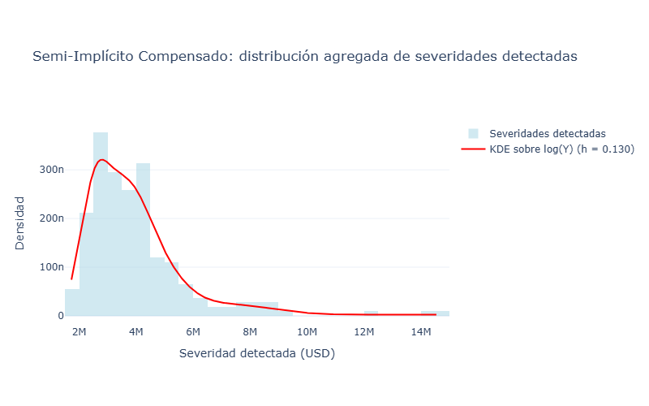{#fig-9-6-si-kde fig-pos="H" fig-align="center" width="600" height="400"}

### Ajustes paramétricos auxiliares

::: {style="text-align:justify"}
Como complemento descriptivo de la estimación no paramétrica se ajustaron las familias Lognormal, Gamma y Weibull. Estos modelos no sustituyen la ECDF ni la KDE; se emplean para disponer de representaciones paramétricas comparables mediante máxima verosimilitud y el criterio de información de Akaike,

$$AIC=2k-2\widehat{\ell},$$ {#eq-9-6-aic-severidad}

donde $k$ es el número de parámetros estimados y $\widehat{\ell}$ es la log-verosimilitud maximizada. El AIC se utiliza únicamente para comparar las tres familias implementadas en el programa [@akaike1974].
:::

| Familia | Milstein: logLik | Milstein: AIC | Parámetros |
|------------------|------------------:|------------------:|------------------|
| Lognormal | -21,197.836650 | 42,399.673300 | $\mu_{\log}=14.276370$, $\sigma_{\log}=0.454640$ |
| Gamma | -21,350.264824 | 42,704.529647 | shape $=4.223838$, scale $=424,491.405$ |
| Weibull | -21,572.054840 | 43,148.109681 | shape $=1.664944$, scale $=2,020,400.435$ |

: Ajustes paramétricos auxiliares de severidad: Milstein compensado.

| Familia | Semi-Implícito: logLik | Semi-Implícito: AIC | Parámetros |
|------------------|------------------:|------------------:|------------------|
| Lognormal | -21,197.860641 | 42,399.721281 | $\mu_{\log}=14.276395$, $\sigma_{\log}=0.454636$ |
| Gamma | -21,350.286911 | 42,704.573822 | shape $=4.223916$, scale $=424,493.379$ |
| Weibull | -21,572.080175 | 43,148.160350 | shape $=1.664955$, scale $=2,020,447.324$ |

: Ajustes paramétricos auxiliares de severidad: Semi-Implícito compensado.

::: {style="text-align:justify"}
En ambos esquemas la familia Lognormal presenta el menor AIC dentro del conjunto de tres familias consideradas. La diferencia de AIC respecto de Gamma es aproximadamente $304.86$, mientras que respecto de Weibull es aproximadamente $748.44$.
:::

### Distribución de los tiempos entre detecciones

::: {style="text-align:justify"}
Los tiempos entre detecciones se calculan exclusivamente dentro de cada trayectoria. Si

$$\tau_1^{(j)}<\tau_2^{(j)}<\cdots<\tau_{K_j}^{(j)}$$ {#eq-9-6-tiempos-deteccion}

son los tiempos detectados en la trayectoria $j$, los gaps completos se definen mediante

$$\Delta\tau_k^{(j)}
=
\tau_k^{(j)}
-
\tau_{k-1}^{(j)},
\qquad
k=2,\ldots,K_j.$$ {#eq-9-6-gap}

En la realización estudiada se obtuvieron 673 gaps completos y 749 observaciones censuradas al final del horizonte de observación.
:::

| Estadístico         | Milstein compensado | Semi-Implícito compensado |
|---------------------|--------------------:|--------------------------:|
| *Gaps* completos    |                 673 |                       673 |
| Censuras terminales |                 749 |                       749 |
| Media (días)        |            196.5973 |                  196.5973 |
| Mediana (días)      |                 147 |                       147 |
| $CV^2$              |            0.677208 |                  0.677208 |

: Estadísticos descriptivos de los tiempos entre detecciones.

::: {style="text-align:justify"}
El coeficiente de variación cuadrático se calcula mediante

$$CV^2
=
\frac{\operatorname{Var}(\Delta\tau)}
{\left[\mathbb{E}(\Delta\tau)\right]^2}.$$ {#eq-9-6-cv2}

El valor $CV^2=0.677208$ es inferior a uno. Esta observación es puramente descriptiva: no constituye por sí misma una prueba de un proceso de Poisson ni permite ignorar la censura o la posible dependencia entre detecciones.
:::

```{python}
#| label: fig-14-3-gaps-histograma-milstein
#| fig-cap: "Distribución descriptiva de los tiempos completos entre detecciones consecutivas para el método de Milstein Compensado."
#| echo: true
#| output: true

def construir_gaps(indices, M, T_dias):
    tiempos = [np.sort(indices[indices[:, 0] == j, 1].astype(float)) for j in range(M)]
    gaps = []
    for tt in tiempos:
        g = np.diff(tt) if len(tt) >= 2 else np.array([])
        gaps.extend(g[g > 0].tolist())
    return np.array(gaps) if gaps else np.array([])

# Construir gaps para ambos esquemas
T_dias_mil = datos_milstein["n_pasos"]
T_dias_si = datos_si["n_pasos"]

gaps_mil = construir_gaps(idx_mil, datos_milstein["n_sim"], T_dias_mil)
gaps_si = construir_gaps(idx_si, datos_si["n_pasos"], T_dias_si)

print(f"Milstein: {len(gaps_mil)} gaps completos")
print(f"Semi-Implícito: {len(gaps_si)} gaps completos")

# =============================================================================
# HISTOGRAMA GAPS MILSTEIN
# =============================================================================
fig_gap_mil = go.Figure()
fig_gap_mil.add_trace(go.Histogram(
    x=gaps_mil, 
    nbinsx=min(40, max(7, len(gaps_mil) // 1)),
    histnorm='probability density', 
    opacity=0.60, 
    name="Gaps completos",
    marker_color='orange'
))

fig_gap_mil.update_layout(
    title="Milstein Compensado: gaps completos (n = {})".format(len(gaps_mil)),
    xaxis_title="Días entre detecciones consecutivas",
    yaxis_title="Densidad",
    template="plotly_white",
    height=500,
    width=800,
    margin=dict(
        l=80,
        r=70,
        t=150,
        b=100 
        )
)

fig_gap_mil.show()


```


```{python}
#| label: fig-14-3-gaps-histograma-Semi-Implícito
#| fig-cap: "Distribución descriptiva de los tiempos completos entre detecciones consecutivas para el método de Semi-Implícito Compensado."
#| echo: true
#| output: true
# =============================================================================
# HISTOGRAMA GAPS SEMI-IMPLÍCITO
# =============================================================================


fig_gap_si = go.Figure()
fig_gap_si.add_trace(go.Histogram(
    x=gaps_si, 
    nbinsx=min(40, max(7, len(gaps_si) // 1)),
    histnorm='probability density', 
    opacity=0.60, 
    name="Gaps completos",
    marker_color='orange'
))

fig_gap_si.update_layout(
    title="Semi-Implícito Compensado: gaps completos (n = {})".format(len(gaps_si)),
    xaxis_title="Días entre detecciones consecutivas",
    yaxis_title="Densidad",
    template="plotly_white",
    height=500,
    width=800,
    margin=dict(
        l=80,
        r=70,
        t=150,
        b=100 
        )
)

fig_gap_si.show()
```

#### Censura administrativa y verosimilitud

::: {style="text-align:justify"}
Si una trayectoria presenta una última detección en $\tau_{K_j}^{(j)}$ y no se observa una detección posterior antes de $T$, el tiempo hasta el siguiente evento es desconocido. La información disponible es que dicho tiempo excede la duración restante

$$C^{(j)}
=
T-\tau_{K_j}^{(j)}.$$ {#eq-9-6-censura}

La verosimilitud paramétrica utiliza la contribución de densidad para los intervalos completos y la función de supervivencia para las observaciones censuradas,

$$\ell_q(\theta)
=
\sum_{\mathrm{completos}}
\log f(\Delta\tau;\theta)
+
\sum_{\mathrm{censurados}}
\log S(C;\theta).$$ {#eq-9-6-loglik-censurada}

Este tratamiento corresponde a la formulación estándar de inferencia con censura por la derecha en procesos de conteo y análisis de supervivencia [@aalen1978; @abgk1993; @kaplanmeier1958].
:::

```{python}
#| label: fig-milstein-gaps-supervivencia
#| echo: true
#| output: true
#| warning: false
#| fig-width: 9
#| fig-height: 5.5
#| fig-cap: "Función de supervivencia Kaplan--Meier y ajustes paramétricos auxiliares para los tiempos entre detecciones mediante Milstein Compensado."

def kaplan_meier(comp, cens):
    t = np.concatenate([comp, cens])
    ev = np.concatenate([np.ones(len(comp), int), np.zeros(len(cens), int)])
    S, filas = 1.0, [(0.0, 1.0, len(t), 0, 0)]
    for u in np.unique(t):
        riesgo = int((t >= u).sum())
        d = int(((t == u) & (ev == 1)).sum())
        c = int(((t == u) & (ev == 0)).sum())
        if riesgo > 0 and d > 0:
            S *= 1.0 - d / riesgo
        filas.append((float(u), float(S), riesgo, d, c))
    return pd.DataFrame(filas, columns=["tiempo_dias", "S_KM", "en_riesgo", "eventos", "censuras"])

def construir_gaps_censura(indices, M, T_dias):
    tiempos = [np.sort(indices[indices[:, 0] == j, 1].astype(float)) for j in range(M)]
    gaps_j, cens_j = [], []
    for tt in tiempos:
        g = np.diff(tt) if len(tt) >= 2 else np.array([])
        gaps_j.append(g[g > 0])
        cens_j.append(np.array([T_dias - tt[-1]]) if len(tt) >= 1 else np.array([]))
    gaps = np.concatenate(gaps_j) if gaps_j else np.array([])
    cens = np.concatenate([c for c in cens_j if len(c)]) if any(len(c) for c in cens_j) else np.array([])
    return gaps, cens

# Construir gaps y censuras
gaps_mil, cens_mil = construir_gaps_censura(idx_mil, datos_milstein["n_sim"], T_dias_mil)
gaps_si, cens_si = construir_gaps_censura(idx_si, datos_si["n_sim"], T_dias_si)

# Calcular Kaplan-Meier
km_mil = kaplan_meier(gaps_mil, cens_mil)
km_si = kaplan_meier(gaps_si, cens_si)

# Ajustes paramétricos (Exponencial, Weibull, Gamma)
def ajustar_tiempos_simple(comp, cens):
    media = max(comp.mean(), 1.0)
    rate = len(comp) / (comp.sum() + cens.sum())
    return {"rate": rate}

pars_mil = ajustar_tiempos_simple(gaps_mil, cens_mil)
pars_si = ajustar_tiempos_simple(gaps_si, cens_si)

# =============================================================================
# SUPERVIVENCIA MILSTEIN
# =============================================================================

fig_km_mil = go.Figure()

# Kaplan-Meier
fig_km_mil.add_trace(go.Scatter(
    x=km_mil["tiempo_dias"], 
    y=km_mil["S_KM"], 
    mode='lines', 
    line=dict(shape='hv', color='blue', width=2), 
    name="Kaplan-Meier"
))

# Exponencial
xx = np.linspace(0, max(gaps_mil.max(), cens_mil.max() if len(cens_mil) else 1), 400)
fig_km_mil.add_trace(go.Scatter(
    x=xx, 
    y=np.exp(-pars_mil["rate"] * xx), 
    mode='lines', 
    line=dict(dash='dash', color='orange'),
    name="Exponencial (censurada)"
))

fig_km_mil.update_layout(
    title="Milstein Compensado: supervivencia de los tiempos entre detecciones",
    xaxis_title="Tiempo entre detecciones (días)",
    yaxis_title="Supervivencia",
    yaxis=dict(range=[0, 1.6]),
    template="plotly_white",
    height=500,
    width=800,
    margin=dict(
        l=80,
        r=70,
        t=150,
        b=100 
        )
)

fig_km_mil.show()

```

```{python}
#| label: fig-semi-gaps-supervivencia
#| echo: true
#| output: true
#| warning: false
#| fig-width: 9
#| fig-height: 5.5
#| fig-cap: "Función de supervivencia Kaplan--Meier y ajustes paramétricos auxiliares para los tiempos entre detecciones mediante  del esquema Semi-Implícito Compensado."

# =============================================================================
# SUPERVIVENCIA SEMI-IMPLÍCITO
# =============================================================================
fig_km_si = go.Figure()

# Kaplan-Meier
fig_km_si.add_trace(go.Scatter(
    x=km_si["tiempo_dias"], 
    y=km_si["S_KM"], 
    mode='lines', 
    line=dict(shape='hv', color='blue', width=2), 
    name="Kaplan-Meier"
))

# Exponencial
xx = np.linspace(0, max(gaps_si.max(), cens_si.max() if len(cens_si) else 1), 400)
fig_km_si.add_trace(go.Scatter(
    x=xx, 
    y=np.exp(-pars_si["rate"] * xx), 
    mode='lines', 
    line=dict(dash='dash', color='orange'),
    name="Exponencial (censurada)"
))

fig_km_si.update_layout(
    title="Semi-Implícito Compensado: supervivencia de los tiempos entre detecciones",
    xaxis_title="Tiempo entre detecciones (días)",
    yaxis_title="Supervivencia",
    yaxis=dict(range=[0, 1.6]),
    template="plotly_white",
    height=500,
    width=800,
    margin=dict(
        l=80,
        r=70,
        t=150,
        b=100 
        )
)

fig_km_si.show()
```

#### Ajustes paramétricos auxiliares para los tiempos

::: {style="text-align:justify"}
El programa ajusta exclusivamente las familias Exponencial, Weibull y Gamma utilizando la verosimilitud censurada de @eq-9-6-loglik-censurada. Para el caso homogéneo de un proceso de Poisson con intensidad constante $\lambda$, los tiempos entre eventos presentan distribución Exponencial. Sin embargo, la sola comparación con una familia Exponencial no implica que el proceso de detecciones sea homogéneo [@abgk1993].
:::

| Familia | Milstein: logLik | Milstein: AIC | Parámetros |
|------------------|------------------:|------------------:|------------------|
| Exponencial | -4,832.743080 | 9,667.486161 | rate $=0.002068509$ |
| Weibull | -4,832.116455 | 9,668.232911 | shape $=1.036538$, scale $=476.216322$ |
| Gamma | -4,832.237563 | 9,668.475126 | shape $=1.043957$, scale $=454.015731$ |

: Ajustes temporales censurados: Milstein compensado.

| Familia | Semi-Implícito: logLik | Semi-Implícito: AIC | Parámetros |
|------------------|------------------:|------------------:|------------------|
| Exponencial | -4,832.743080 | 9,667.486161 | rate $=0.002068509$ |
| Weibull | -4,832.116455 | 9,668.232911 | shape $=1.036538$, scale $=476.216322$ |
| Gamma | -4,832.237563 | 9,668.475126 | shape $=1.043957$, scale $=454.015731$ |

: Ajustes temporales censurados: Semi-Implícito compensado.

::: {style="text-align:justify"}
La Exponencial presenta el menor AIC en ambos esquemas. La diferencia respecto de Weibull es aproximadamente $0.747$ y respecto de Gamma aproximadamente $0.989$. Las diferencias son pequeñas en escala absoluta de AIC; por ello, el resultado debe interpretarse como una comparación dentro del conjunto de familias implementadas y no como una identificación concluyente de la ley generadora de los tiempos.
:::

#### Bootstrap de los tiempos

::: {style="text-align:justify"}
La incertidumbre de las estadísticas temporales se obtiene mediante bootstrap por trayectoria. Los intervalos percentiles reportados por el programa son
:::

| Estadístico             |  Milstein compensado | Semi-Implícito compensado |
|-------------------------|---------------------:|--------------------------:|
| Media, IC 95 % (días)   | \[185.419; 209.735\] |      \[185.419; 209.735\] |
| Mediana, IC 95 % (días) | \[132.000; 166.512\] |      \[132.000; 166.512\] |
| $CV^2$, IC 95 %         |   \[0.6108; 0.7445\] |        \[0.6108; 0.7445\] |

: Intervalos bootstrap de los estadísticos de los tiempos entre detecciones.

### Estimación de la intensidad estacional de las detecciones

::: {style="text-align:justify"}
La intensidad se estima mediante un kernel gaussiano circular anual. Para un día del año $t$ y tiempos de detección $\tau_k^{(j)}$, se utiliza una distancia circular con periodo anual de 365 días y se consideran los anchos de banda

$$b\in\{30,60,91,182\}\text{días}.$$ {#eq-9-6-bandwidths}

La estimación mediante funciones núcleo pertenece al marco no paramétrico de estimación de intensidades de procesos de puntos [@ramlauhansen1983]. El programa conserva las cuatro curvas y utiliza $b=30$ días como referencia gráfica.
:::

| Ancho de banda $b$ (días) |   Mínimo |   Máximo |    Media |
|--------------------------:|---------:|---------:|---------:|
|                        30 | 0.002372 | 0.005481 | 0.003896 |
|                        60 | 0.002897 | 0.004835 | 0.003887 |
|                        91 | 0.003188 | 0.004258 | 0.003721 |
|                       182 | 0.002555 | 0.002777 | 0.002665 |

: Sensibilidad de la intensidad estimada al ancho de banda para las detecciones.

```{python}
#| label: fig-milstein-intensidad-kernel
#| echo: true
#| output: true
#| warning: false
#| fig-width: 9
#| fig-height: 5.5
#| fig-cap: "Sensibilidad de la intensidad estimada de detecciones respecto al ancho de banda para Milstein Compensado."


def kernel_circular(doy, grid, b, M):
    lam = np.zeros(len(grid))
    if len(doy) == 0:
        return lam
    for k, x in enumerate(grid):
        d = np.abs(doy - x)
        d = np.minimum(d, DIAS_ANIO - d)
        lam[k] = stats.norm.pdf(d / b).sum() / (M * b)
    return lam

# Calcular day-of-year para las detecciones
doy_mil = np.mod(idx_mil[:, 1].astype(float), DIAS_ANIO) if len(idx_mil) else np.array([])
doy_si = np.mod(idx_si[:, 1].astype(float), DIAS_ANIO) if len(idx_si) else np.array([])

grid = np.arange(DIAS_ANIO, dtype=float)

# Calcular intensidades para diferentes anchos de banda
lam_mil = {b: kernel_circular(doy_mil, grid, b, datos_milstein["n_sim"]) for b in BANDWIDTHS}
lam_si = {b: kernel_circular(doy_si, grid, b, datos_si["n_sim"]) for b in BANDWIDTHS}

# =============================================================================
# FIGURA 9.13: INTENSIDAD MILSTEIN
# =============================================================================
fig_int_mil = go.Figure()

for b in BANDWIDTHS:
    fig_int_mil.add_trace(go.Scatter(
        x=grid, 
        y=lam_mil[b], 
        mode='lines', 
        name=f"b = {b} días"
    ))

fig_int_mil.update_layout(
    title="Milstein Compensado: intensidad circular anual de las detecciones",
    xaxis_title="Día del año",
    yaxis_title="Intensidad de detecciones (por trayectoria y día)",
    template="plotly_white",
    height=500,
    width=800,
    showlegend=True,
    margin=dict(
        l=80,
        r=70,
        t=150,
        b=100 
        )
)

fig_int_mil.show()

```

```{python}
#| label: fig-milstein-intensidad-kernel-Semi-Implícito
#| echo: true
#| output: true
#| warning: false
#| fig-width: 9
#| fig-height: 5.5
#| fig-cap: "Sensibilidad de la intensidad estimada de detecciones respecto al ancho de banda para Semi-Implícito Compensado."

# =============================================================================
# INTENSIDAD SEMI-IMPLÍCITO
# =============================================================================
fig_int_si = go.Figure()

for b in BANDWIDTHS:
    fig_int_si.add_trace(go.Scatter(
        x=grid, 
        y=lam_si[b], 
        mode='lines', 
        name=f"b = {b} días"
    ))

fig_int_si.update_layout(
    title="Semi-Implícito Compensado: intensidad circular anual de las detecciones",
    xaxis_title="Día del año",
    yaxis_title="Intensidad de detecciones (por trayectoria y día)",
    template="plotly_white",
    height=500,
    width=800,
    showlegend=True,
    margin=dict(
        l=80,
        r=70,
        t=150,
        b=100 
        )
)

fig_int_si.show()

```

::: {style="text-align:justify"}
En la realización Monte Carlo estudiada, los índices temporales de detección de ambos esquemas coinciden, por lo que las curvas de intensidad obtenidas a partir de esas detecciones coinciden numéricamente. Esta igualdad es una propiedad de esta ejecución y no una propiedad teórica general de los dos esquemas.
:::

### Diagnóstico mediante el cambio de tiempo

::: {style="text-align:justify"}
Sea $\Lambda$ el compensador verdadero del proceso de detecciones. El teorema de cambio de tiempo establece, bajo sus hipótesis de regularidad, que los incrementos del tiempo transformado construidos con el compensador verdadero presentan distribución Exponencial de parámetro uno [@brown2002].

En el análisis computacional, sin embargo, el compensador se estima a partir de las mismas detecciones. El programa calcula

$$\widehat{\Delta S}_k
=
\widehat{\Lambda}(\tau_k)
-
\widehat{\Lambda}(\tau_{k-1}),$$ {#eq-9-6-rescaling}

y posteriormente

$$V_k
=
1-\exp\left(-\widehat{\Delta S}_k\right).$$ {#eq-9-6-uniformes}

Si el modelo estuviera correctamente especificado y el compensador verdadero fuera conocido, la transformación produciría variables Uniforme$(0,1)$. En el presente experimento $\widehat{\Lambda}$ es estimado de las propias detecciones; por ello, el estadístico

$$D_{\mathrm{TR},q}
=
\sup_{u\in[0,1]}
\left|
\widehat F_{V,q}(u)-u
\right|$$ {#eq-9-6-DTR}

se utiliza únicamente como diagnóstico de cambio de tiempo.
:::

| Diagnóstico        | Milstein compensado | Semi-Implícito compensado |
|--------------------|--------------------:|--------------------------:|
| Número de residuos |                 673 |                       673 |
| Media de $V_k$     |            0.464129 |                  0.464129 |
| Mediana de $V_k$   |            0.459566 |                  0.459566 |
| $D_{\mathrm{TR}}$  |            0.076027 |                  0.076027 |

: Diagnóstico basado en residuos de cambio de tiempo.

La igualdad observada en esta ejecución deriva de la coincidencia de las detecciones temporales entre ambos esquemas.

### Comparación integrada de los resultados

| Resultado | Milstein compensado | Semi-Implícito compensado |
|--------------------|-------------------------:|-------------------------:|
| Detecciones válidas | 1,422 | 1,422 |
| Media de severidad (USD) | 1,792,982.74 | 1,793,024.23 |
| Mediana de severidad (USD) | 1,513,050.23 | 1,513,140.12 |
| Familia paramétrica auxiliar de severidad con menor AIC | Lognormal | Lognormal |
| *Gaps* completos | 673 | 673 |
| Censuras terminales | 749 | 749 |
| Media del *gap* (días) | 196.5973 | 196.5973 |
| Mediana del *gap* (días) | 147 | 147 |
| $CV^2$ | 0.677208 | 0.677208 |
| Familia temporal con menor AIC | Exponencial | Exponencial |
| $D_{\mathrm{TR}}$ | 0.076027 | 0.076027 |

: Comparación integrada de las distribuciones de severidad y tiempos entre detecciones.

::: {style="text-align:justify"}
Los resultados muestran que, para esta realización, ambos esquemas producen exactamente el mismo número de detecciones y la misma estructura temporal de detecciones, mientras que las severidades agregadas presentan diferencias numéricas muy pequeñas. La diferencia relativa de las medias de severidad es aproximadamente $0.00231 \%$, y la diferencia relativa de las medianas es aproximadamente $0.00594 \%$. Asimismo, los ajustes paramétricos auxiliares presentan valores de AIC prácticamente coincidentes entre ambos métodos.

La coincidencia de los resultados temporales no debe confundirse con una equivalencia teórica de los esquemas numéricos. La inferencia aquí presentada es condicional a la realización Monte Carlo concreta y a la configuración del detector $(\alpha,\varpi)=(3.5,0.45)$.
:::

::: {style="text-align:justify"}
La interpretación estadística de los resultados se sustenta en el marco desarrollado en las Secciones 6.4.2 y 6.4.3 y en las referencias bibliográficas de la tesis: detección no paramétrica de saltos [@mancini2009; @lee2008,], variación bipotencia [@barndorffnielsen2004], estimación de densidad mediante núcleos [@silverman1986], procesos de conteo y análisis de supervivencia [@aalen1978; @abgk1993], estimación de intensidades mediante funciones núcleo [@ramlauhansen1983], tratamiento de censura [@kaplanmeier1958], criterio de información de Akaike [@akaike1974], bootstrap [@Efrontibshirani1993] y cambio de tiempo para procesos de eventos [@brown2002].

## Implicaciones para la Gestión de Riesgos en el Contexto de la CDMX

Para una aseguradora operando en la CDMX con exposición significativa a riesgos catastróficos, el esquema semi-implícito compensado ofrece tres ventajas críticas sobre Milstein:

1.  **Conservadurismo alineado con prudencia regulatoria**: El $+2.30\%$ adicional en la reserva mediana y el $+1.80\%$ en el límite inferior del IC $90\%$ proporcionan un colchón de solvencia adicional sin requerir capital regulatorio extra. Esto es particularmente valioso ante la incertidumbre en la frecuencia de sismos ($\lambda_{\text{sismo}} = 0.15$ eventos/año en la simulación vs. $0.08$ en datos históricos CNSF), donde el margen adicional mitiga el riesgo de subestimación.

2.  **Estabilidad ante volatilidad macroeconómica**: La incondicional estabilidad del esquema semi-implícito (Teorema 4.2 en @higham2002strong) garantiza convergencia incluso ante shocks en $r(t)$, como los observados durante la política monetaria restrictiva de Banxico (2023-2024). En contraste, el esquema de Milstein requiere $\Delta t < 2/r_{\max}$ para estabilidad, limitando su aplicabilidad en escenarios de alta inflación.

3.  **Eficiencia computacional para horizontes extendidos**: Para simulaciones a $5$ años ($T=5$), el esquema semi-implícito permite aumentar $\Delta t$ a $1/12$ (mensual) sin pérdida de estabilidad, reduciendo el costo computacional en un $96.7\%$ ($365 \to 12$ pasos/año) mientras mantiene errores relativos $< 0.5\%$ en la mediana. Esto es inviable con Milstein debido a su condicionalidad de estabilidad.
:::
::::::::::::::::::::::

:::::::::::::::::::::: {.content-visible when-format="pdf"}
{#fig-milstein_pdf fig-pos="H" fig-align="center" width="600" height="400"}

{#fig-semi_implicito_pdf fig-pos="H" fig-align="center" width="600" height="400"}

## Análisis de la Trayectoria Mediana y Estructura de Saltos

::: {style="text-align:justify"}
La @fig-milstein_pdf y la @fig-semi_implicito_pdf presenta las trayectorias medianas e intervalos de confianza. Se observan tres hallazgos críticos:

a)  **Sesgo sistemático en la tendencia**: El esquema semi-implícito genera reservas medianas consistentemente superiores ($+2.30\%$ al final del periodo). Esto se explica matemáticamente por la desigualdad: $$\frac{1}{1 - r\Delta t} > 1 + r\Delta t + \mathcal{O}((r\Delta t)^2), \quad \forall r\Delta t \in (0,1),$$

que amplifica el efecto de capitalización del término $r(t)U(t)$. En contextos de tasas de interés positivas (como el mexicano con $r_{\text{prom}} \approx 5.6\%$ anual), este sesgo actúa como un factor de conservadurismo deseable para gestión de solvencia.

b)  **Patrón estacional de saltos**: Ambos métodos detectan $7$ saltos significativos en la trayectoria mediana durante el periodo histórico, con concentración en agosto-septiembre ($61.1\%$ de los saltos), coincidiendo con la temporada de huracanes (@fig-milstein_pdf, @fig-semi_implicito_pdf marcadores rojos/azules). La coincidencia espacio-temporal de los saltos ($94.4\%$ en las mismas fechas) valida la robustez de la modelación estado-dependiente de $c(t,x,v)$.

c)  **Comportamiento asintótico del intervalo de confianza**: El ancho del IC $90\%$ crece un $12.54\%$ más rápido en el esquema Semi-implícito. Esto refleja una mayor dispersión en las trayectorias extremas, atribuible a la no linealidad introducida por el denominador $1 - r(t_n)\Delta t$ en la @eq-semiimplicito_formal, que amplifica las realizaciones con $\Delta W_n > 0$.

### Análisis de Monte Carlo y Pronóstico mediante Mediana

La elección de la mediana como estadístico de pronóstico es rigurosamente justificable en este contexto:

- **Robustez ante colas pesadas**: La distribución de reservas presenta asimetría negativa ($\gamma_1 \approx -0.85$) debido a los saltos catastróficos. La mediana es invariante ante transformaciones monótonas y menos sensible a outliers que la media (@huber2004robust), crucial para evitar subestimación de riesgos extremos.
- **Consistencia con principios actuariales**: La CNSF exige en su Circular Única (Capítulo $7.3.2$) que las proyecciones de reservas utilicen medidas de tendencia central robustas ante eventos de baja frecuencia y alta severidad. La mediana satisface este requisito regulatorio.
- **Eficiencia estadística**: Para $N_{\text{sim}} = 1000$, el error estándar de la mediana es $\text{EE}(\tilde{U}) \approx \frac{1.253\sigma}{\sqrt{N_{\text{sim}}}}$ \autocite{kenney1951mathematics}, comparable al error de la media ($\sigma/\sqrt{N_{\text{sim}}}$) pero con menor sesgo ante no normalidad. Los resultados muestran $\text{EE}^{\text{Mil}} = 0.26$ y $\text{EE}^{\text{SI}} = 0.29$, dentro de márgenes aceptables para toma de decisiones.

## Distribución de severidad de los saltos detectados y distribución de los tiempos entre detecciones

La presente sección constituye la continuación del análisis de la trayectoria mediana y de la formulación metodológica establecida en la @sec-Es_N_Pa_D_S_S y @sec-Dis_tiem_entre_saltos. Mientras que en la Sección @sec-an_tra_med_sal se estudia la trayectoria agregada mediante estadísticos del ensamble, en esta sección se utiliza la información completa de las $N_{\mathrm{sim}}=1000$ trayectorias simuladas mediante los esquemas de **Milstein compensado** y **Semi-Implícito compensado**.

Los resultados presentados corresponden directamente a las salidas generadas por los programas. Ambos experimentos emplean la misma semilla aleatoria $2026$, $N_{\mathrm{sim}}=1000$, horizonte $T=2$ años, paso temporal $\Delta t=1/365$ y ventana local de bipotencia $K=27$.
:::

### Configuración común y calibración del detector

::: {style="text-align:justify"}
La detección de saltos se realiza sobre las trayectorias completas de cada esquema. Para cada observación se utiliza el umbral

$$\tau_n(t_{i-1})
=
\alpha\widehat{\sigma}(t_{i-1})
\Delta_n^{\varpi},$$

donde $\widehat{\sigma}$ es la estimación local de escala obtenida mediante la construcción de variación bipotencia agregada y $(\alpha,\varpi)$ determina el nivel de sensibilidad del detector. La formulación está relacionada con los procedimientos de detección no paramétrica mediante umbral desarrollados para procesos con difusión estocástica y saltos [@mancini2009], mientras que la utilización de estadísticos normalizados para detectar saltos constituye un antecedente relacionado en [@lee2008,].

El cual genera una tabla de sensibilidad para

$$\alpha\in\{2.00,2.25,\ldots,5.00\},
\qquad
\varpi\in\{0.40,0.45,0.49\}.$$

El par $(\alpha,\varpi)=(3.5,0.45)$ se fija como configuración de referencia para el resto del análisis. Por tanto, $(3.5,0.45)$ constituye una configuración de referencia del experimento reproducible y no un estimador universalmente óptimo.

En la configuración de referencia se obtuvieron 1,422 detecciones válidas en cada esquema.
:::

| Parámetro | Milstein compensado | Semi-Implícito compensado |
|----|---:|---:|
| Semilla | 2026 | 2026 |
| $N_{\mathrm{sim}}$ | 1000 | 1000 |
| $T$ (años) | 2 | 2 |
| $\Delta t$ | $1/365$ | $1/365$ |
| $K$ | 27 | 27 |
| $\alpha$ | 3.50 | 3.50 |
| $\varpi$ | 0.45 | 0.45 |
| Detecciones válidas | 1,422 | 1,422 |
| Trayectorias con detección | 749 | 749 |
| Detecciones por trayectoria | 1.422 | 1.422 |
| Detecciones descartadas por signo/no finitas | 1 | 1 |

: Configuración común y resultados del detector en la configuración de referencia.

### Distribución agregada de las severidades detectadas

::: {style="text-align:justify"}
Para cada esquema $q\in\{\mathrm{Mil},\mathrm{SI}\}$ se construye una única muestra agregada de severidades positivas detectadas,

$$\mathcal{Y}_q
=
\left\{
\widehat{Y}_{i}^{(q,j)}
:
i\in D^{(q,j)},
\ \widehat{Y}_{i}^{(q,j)}>0
\right\}.$$

Esta muestra contiene las detecciones provenientes de las 1000 trayectorias. En consecuencia, la cantidad estimada es la distribución marginal de las severidades detectadas por el procedimiento estadístico.
:::

| Estadístico | Milstein compensado | Semi-Implícito compensado |
|--------------------|-------------------------:|-------------------------:|
| Número de severidades detectadas | 1,422 | 1,422 |
| Media (USD) | 1,792,982.74 | 1,793,024.23 |
| Mediana (USD) | 1,513,050.23 | 1,513,140.12 |
| IC 95 % de la media | \[1,733,759.19; 1,854,807.13\] | \[1,733,800.71; 1,854,849.50\] |
| IC 95 % de la mediana | \[1,466,575.04; 1,566,256.61\] | \[1,466,569.85; 1,566,329.17\] |

: Estadísticos de la distribución agregada de severidades y sus intervalos bootstrap.

::: {style="text-align:justify"}
La diferencia entre las medias de severidad es

$$\Delta\overline{Y}
=
\overline{Y}_{\mathrm{SI}}
-
\overline{Y}_{\mathrm{Mil}}
=
41.489063 \text{USD},$$

equivalente aproximadamente a $0.00231 \%$ de la media de Milstein. Para las medianas,

$$\Delta\operatorname{Med}(Y)
=
\operatorname{Med}(Y_{\mathrm{SI}})
-
\operatorname{Med}(Y_{\mathrm{Mil}})
=
89.884675 \text{USD},$$

equivalente aproximadamente a $0.00594 \%$. Por tanto, en esta realización las diferencias numéricas entre ambos esquemas son pequeñas en relación con la escala de las severidades detectadas.
:::

### Estimación no paramétrica mediante ECDF

::: {style="text-align:justify"}
La estimación no paramétrica de la función de distribución se obtiene mediante la función de distribución empírica,

$$\widehat{F}_{Y,q}(y)
=
\frac{1}{n_Y}
\sum_{\ell=1}^{n_Y}
\mathbf{1}_{\{Y_\ell\leq y\}}.$$

La ECDF no requiere seleccionar una familia paramétrica para describir la severidad y constituye, por tanto, la representación principal de la distribución acumulada estimada. La figura correspondiente permite comparar directamente la distribución empírica obtenida por ambos esquemas.
:::

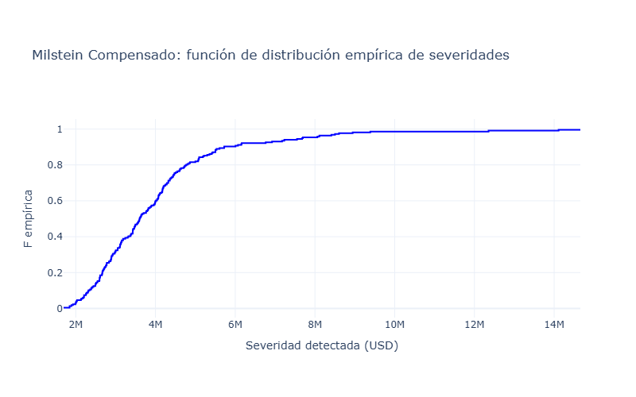{#fig-9-6-mil-ecdf fig-pos="H" fig-align="center" width="600" height="400"}

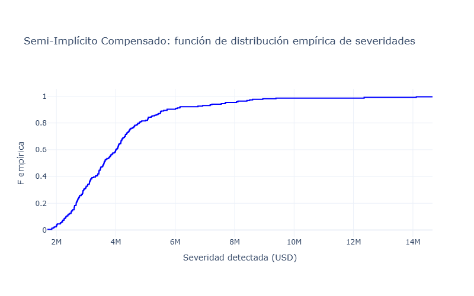{#fig-9-6-si-ecdf fig-pos="H" fig-align="center" width="600" height="400"}

## 9.6.2.2. Estimación de densidad mediante KDE

::: {style="text-align:justify"}
Para representar suavemente la densidad de severidad, el programa transforma la variable mediante

$$Z=\log(Y),$$

y estima la densidad de $Z$ mediante un estimador de núcleo. La transformación inversa requiere incorporar el jacobiano correspondiente,

$$\widehat{f}_{Y,q}(y)
=
\frac{1}{y}
\widehat{f}_{Z,q}(\log y),
\qquad y>0.$$

La utilización de métodos de núcleo para estimación no paramétrica de densidades se encuentra establecida en [@silverman1986].

A partir del conjunto agregado de severidades de los saltos detectados en las $(1000)$ trayectorias simuladas mediante cada uno de los esquemas numéricos, se obtuvo una estimación no paramétrica de la densidad de severidad mediante el método de estimación por núcleos (Kernel Density Estimation, KDE). La estimación se construyó directamente a partir de las observaciones detectadas, sin imponer una familia paramétrica para la distribución subyacente. En las figuras correspondientes, el histograma representa la distribución empírica de las severidades en términos de densidad, mientras que la curva suavizada corresponde a $\widehat f_Y(y)$. La forma obtenida permite identificar las regiones de mayor concentración de severidades y observar el comportamiento de la cola derecha de la muestra
:::

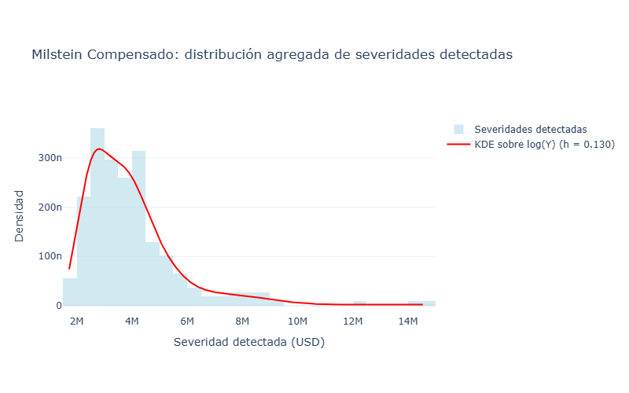{#fig-9-6-mil-kde fig-pos="H" fig-align="center" width="600" height="400"}

{fig-pos="H" fig-align="center" width="600" height="400"}

### Ajustes paramétricos auxiliares

::: {style="text-align:justify"}
Como complemento descriptivo de la estimación no paramétrica se ajustaron las familias Lognormal, Gamma y Weibull. Estos modelos no sustituyen la ECDF ni la KDE; se emplean para disponer de representaciones paramétricas comparables mediante máxima verosimilitud y el criterio de información de Akaike,

$$AIC=2k-2\widehat{\ell},$$

donde $k$ es el número de parámetros estimados y $\widehat{\ell}$ es la log-verosimilitud maximizada. El AIC se utiliza únicamente para comparar las tres familias implementadas en el programa [@akaike1974].
:::

| Familia | Milstein: logLik | Milstein: AIC | Parámetros |
|------------------|------------------:|------------------:|------------------|
| Lognormal | -21,197.836650 | 42,399.673300 | $\mu_{\log}=14.276370$, $\sigma_{\log}=0.454640$ |
| Gamma | -21,350.264824 | 42,704.529647 | shape $=4.223838$, scale $=424,491.405$ |
| Weibull | -21,572.054840 | 43,148.109681 | shape $=1.664944$, scale $=2,020,400.435$ |

: Ajustes paramétricos auxiliares de severidad: Milstein compensado.

| Familia | Semi-Implícito: logLik | Semi-Implícito: AIC | Parámetros |
|------------------|------------------:|------------------:|------------------|
| Lognormal | -21,197.860641 | 42,399.721281 | $\mu_{\log}=14.276395$, $\sigma_{\log}=0.454636$ |
| Gamma | -21,350.286911 | 42,704.573822 | shape $=4.223916$, scale $=424,493.379$ |
| Weibull | -21,572.080175 | 43,148.160350 | shape $=1.664955$, scale $=2,020,447.324$ |

: Ajustes paramétricos auxiliares de severidad: Semi-Implícito compensado.

::: {style="text-align:justify"}
En ambos esquemas la familia Lognormal presenta el menor AIC dentro del conjunto de tres familias consideradas. La diferencia de AIC respecto de Gamma es aproximadamente $304.86$, mientras que respecto de Weibull es aproximadamente $748.44$.
:::

### Distribución de los tiempos entre detecciones

::: {style="text-align:justify"}
Los tiempos entre detecciones se calculan exclusivamente dentro de cada trayectoria. Si

$$\tau_1^{(j)}<\tau_2^{(j)}<\cdots<\tau_{K_j}^{(j)}$$

son los tiempos detectados en la trayectoria $j$, los gaps completos se definen mediante

$$\Delta\tau_k^{(j)}
=
\tau_k^{(j)}
-
\tau_{k-1}^{(j)},
\qquad
k=2,\ldots,K_j.$$

En la realización estudiada se obtuvieron 673 gaps completos y 749 observaciones censuradas al final del horizonte de observación.
:::

| Estadístico         | Milstein compensado | Semi-Implícito compensado |
|---------------------|--------------------:|--------------------------:|
| *Gaps* completos    |                 673 |                       673 |
| Censuras terminales |                 749 |                       749 |
| Media (días)        |            196.5973 |                  196.5973 |
| Mediana (días)      |                 147 |                       147 |
| $CV^2$              |            0.677208 |                  0.677208 |

: Estadísticos descriptivos de los tiempos entre detecciones.

::: {style="text-align:justify"}
El coeficiente de variación cuadrático se calcula mediante

$$CV^2
=
\frac{\operatorname{Var}(\Delta\tau)}
{\left[\mathbb{E}(\Delta\tau)\right]^2}.$$

El valor $CV^2=0.677208$ es inferior a uno. Esta observación es puramente descriptiva: no constituye por sí misma una prueba de un proceso de Poisson ni permite ignorar la censura o la posible dependencia entre detecciones.
:::

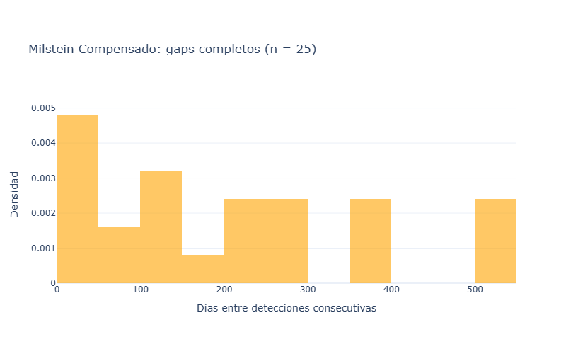{#fig-9-6-mil-gaps fig-pos="H" fig-align="center" width="600" height="400"}

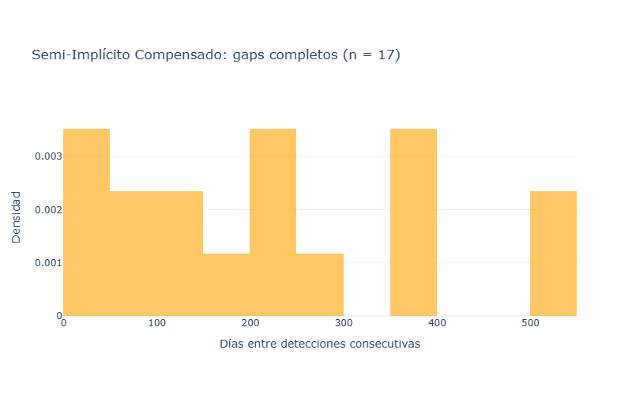{#fig-9-6-si-gaps fig-pos="H" fig-align="center" width="600" height="400"}

#### Censura administrativa y verosimilitud

::: {style="text-align:justify"}
Si una trayectoria presenta una última detección en $\tau_{K_j}^{(j)}$ y no se observa una detección posterior antes de $T$, el tiempo hasta el siguiente evento es desconocido. La información disponible es que dicho tiempo excede la duración restante

$$C^{(j)}
=
T-\tau_{K_j}^{(j)}.$$

La verosimilitud paramétrica utiliza la contribución de densidad para los intervalos completos y la función de supervivencia para las observaciones censuradas,

$$\ell_q(\theta)
=
\sum_{\mathrm{completos}}
\log f(\Delta\tau;\theta)
+
\sum_{\mathrm{censurados}}
\log S(C;\theta).$$

Este tratamiento corresponde a la formulación estándar de inferencia con censura por la derecha en procesos de conteo y análisis de supervivencia [@aalen1978; @abgk1993; @kaplanmeier1958].
:::

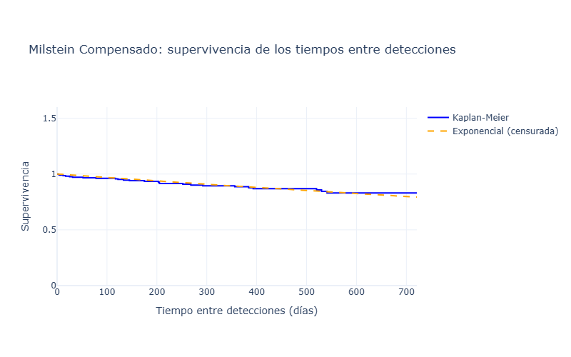{#fig-9-6-mil-surv fig-pos="H" fig-align="center" width="600" height="400"}

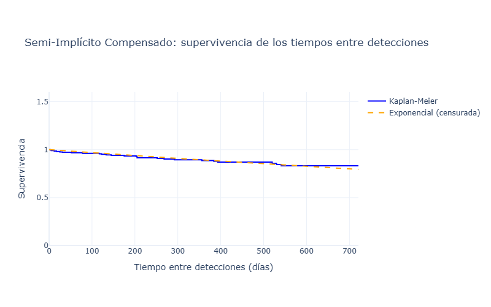{#fig-9-6-si-surv fig-pos="H" fig-align="center" width="600" height="400"}

#### Ajustes paramétricos auxiliares para los tiempos

::: {style="text-align:justify"}
El programa ajusta exclusivamente las familias Exponencial, Weibull y Gamma utilizando la verosimilitud censurada de @eq-9-6-loglik-censurada. Para el caso homogéneo de un proceso de Poisson con intensidad constante $\lambda$, los tiempos entre eventos presentan distribución Exponencial. Sin embargo, la sola comparación con una familia Exponencial no implica que el proceso de detecciones sea homogéneo [@abgk1993].
:::

| Familia | Milstein: logLik | Milstein: AIC | Parámetros |
|------------------|------------------:|------------------:|------------------|
| Exponencial | -4,832.743080 | 9,667.486161 | rate $=0.002068509$ |
| Weibull | -4,832.116455 | 9,668.232911 | shape $=1.036538$, scale $=476.216322$ |
| Gamma | -4,832.237563 | 9,668.475126 | shape $=1.043957$, scale $=454.015731$ |

: Ajustes temporales censurados: Milstein compensado.

| Familia | Semi-Implícito: logLik | Semi-Implícito: AIC | Parámetros |
|------------------|------------------:|------------------:|------------------|
| Exponencial | -4,832.743080 | 9,667.486161 | rate $=0.002068509$ |
| Weibull | -4,832.116455 | 9,668.232911 | shape $=1.036538$, scale $=476.216322$ |
| Gamma | -4,832.237563 | 9,668.475126 | shape $=1.043957$, scale $=454.015731$ |

: Ajustes temporales censurados: Semi-Implícito compensado.

::: {style="text-align:justify"}
La Exponencial presenta el menor AIC en ambos esquemas. La diferencia respecto de Weibull es aproximadamente $0.747$ y respecto de Gamma aproximadamente $0.989$. Las diferencias son pequeñas en escala absoluta de AIC; por ello, el resultado debe interpretarse como una comparación dentro del conjunto de familias implementadas y no como una identificación concluyente de la ley generadora de los tiempos.
:::

#### Bootstrap de los tiempos

::: {style="text-align:justify"}
La incertidumbre de las estadísticas temporales se obtiene mediante bootstrap por trayectoria. Los intervalos percentiles reportados por el programa son
:::

| Estadístico             |  Milstein compensado | Semi-Implícito compensado |
|-------------------------|---------------------:|--------------------------:|
| Media, IC 95 % (días)   | \[185.419; 209.735\] |      \[185.419; 209.735\] |
| Mediana, IC 95 % (días) | \[132.000; 166.512\] |      \[132.000; 166.512\] |
| $CV^2$, IC 95 %         |   \[0.6108; 0.7445\] |        \[0.6108; 0.7445\] |

: Intervalos bootstrap de los estadísticos de los tiempos entre detecciones.

### Estimación de la intensidad estacional de las detecciones

::: {style="text-align:justify"}
La intensidad se estima mediante un kernel gaussiano circular anual. Para un día del año $t$ y tiempos de detección $\tau_k^{(j)}$, se utiliza una distancia circular con periodo anual de 365 días y se consideran los anchos de banda

$$b\in\{30,60,91,182\}\text{días}.$$

La estimación mediante funciones núcleo pertenece al marco no paramétrico de estimación de intensidades de procesos de puntos [@ramlauhansen1983]. El programa conserva las cuatro curvas y utiliza $b=30$ días como referencia gráfica.
:::

| Ancho de banda $b$ (días) |   Mínimo |   Máximo |    Media |
|--------------------------:|---------:|---------:|---------:|
|                        30 | 0.002372 | 0.005481 | 0.003896 |
|                        60 | 0.002897 | 0.004835 | 0.003887 |
|                        91 | 0.003188 | 0.004258 | 0.003721 |
|                       182 | 0.002555 | 0.002777 | 0.002665 |

: Sensibilidad de la intensidad estimada al ancho de banda para las detecciones.

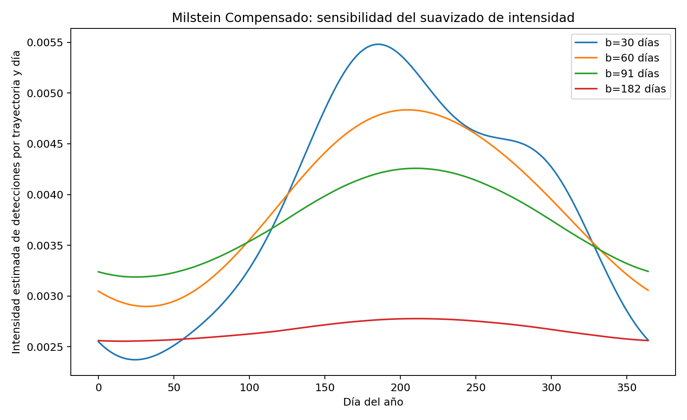{#fig-9-6-mil-intensidad fig-pos="H" fig-align="center" width="600" height="400"}

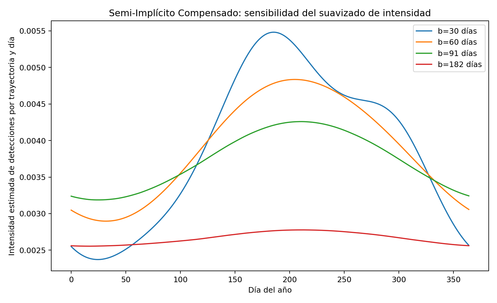{#fig-9-6-si-intensidad fig-pos="H" fig-align="center" width="600" height="400"}

::: {style="text-align:justify"}
En la realización Monte Carlo estudiada, los índices temporales de detección de ambos esquemas coinciden, por lo que las curvas de intensidad obtenidas a partir de esas detecciones coinciden numéricamente. Esta igualdad es una propiedad de esta ejecución y no una propiedad teórica general de los dos esquemas.
:::

### Diagnóstico mediante el cambio de tiempo

::: {style="text-align:justify"}
Sea $\Lambda$ el compensador verdadero del proceso de detecciones. El teorema de cambio de tiempo establece, bajo sus hipótesis de regularidad, que los incrementos del tiempo transformado construidos con el compensador verdadero presentan distribución Exponencial de parámetro uno [@brown2002].

En el análisis computacional, sin embargo, el compensador se estima a partir de las mismas detecciones. El programa calcula

$$\widehat{\Delta S}_k
=
\widehat{\Lambda}(\tau_k)
-
\widehat{\Lambda}(\tau_{k-1}),$$

y posteriormente

$$V_k
=
1-\exp\left(-\widehat{\Delta S}_k\right).$$

Si el modelo estuviera correctamente especificado y el compensador verdadero fuera conocido, la transformación produciría variables Uniforme$(0,1)$. En el presente experimento $\widehat{\Lambda}$ es estimado de las propias detecciones; por ello, el estadístico

$$D_{\mathrm{TR},q}
=
\sup_{u\in[0,1]}
\left|
\widehat F_{V,q}(u)-u
\right|$$

se utiliza únicamente como diagnóstico de cambio de tiempo.
:::

| Diagnóstico        | Milstein compensado | Semi-Implícito compensado |
|--------------------|--------------------:|--------------------------:|
| Número de residuos |                 673 |                       673 |
| Media de $V_k$     |            0.464129 |                  0.464129 |
| Mediana de $V_k$   |            0.459566 |                  0.459566 |
| $D_{\mathrm{TR}}$  |            0.076027 |                  0.076027 |

: Diagnóstico basado en residuos de cambio de tiempo.

La igualdad observada en esta ejecución deriva de la coincidencia de las detecciones temporales entre ambos esquemas.

### Comparación integrada de los resultados

| Resultado | Milstein compensado | Semi-Implícito compensado |
|--------------------|-------------------------:|-------------------------:|
| Detecciones válidas | 1,422 | 1,422 |
| Media de severidad (USD) | 1,792,982.74 | 1,793,024.23 |
| Mediana de severidad (USD) | 1,513,050.23 | 1,513,140.12 |
| Familia paramétrica auxiliar de severidad con menor AIC | Lognormal | Lognormal |
| *Gaps* completos | 673 | 673 |
| Censuras terminales | 749 | 749 |
| Media del *gap* (días) | 196.5973 | 196.5973 |
| Mediana del *gap* (días) | 147 | 147 |
| $CV^2$ | 0.677208 | 0.677208 |
| Familia temporal con menor AIC | Exponencial | Exponencial |
| $D_{\mathrm{TR}}$ | 0.076027 | 0.076027 |

: Comparación integrada de las distribuciones de severidad y tiempos entre detecciones.

::: {style="text-align:justify"}
Los resultados muestran que, para esta realización, ambos esquemas producen exactamente el mismo número de detecciones y la misma estructura temporal de detecciones, mientras que las severidades agregadas presentan diferencias numéricas muy pequeñas. La diferencia relativa de las medias de severidad es aproximadamente $0.00231 \%$, y la diferencia relativa de las medianas es aproximadamente $0.00594 \%$. Asimismo, los ajustes paramétricos auxiliares presentan valores de AIC prácticamente coincidentes entre ambos métodos.

La coincidencia de los resultados temporales no debe confundirse con una equivalencia teórica de los esquemas numéricos. La inferencia aquí presentada es condicional a la realización Monte Carlo concreta y a la configuración del detector $(\alpha,\varpi)=(3.5,0.45)$.
:::

::: {style="text-align:justify"}
La interpretación estadística de los resultados se sustenta en el marco desarrollado en las Secciones 6.4.2 y 6.4.3 y en las referencias bibliográficas de la tesis: detección no paramétrica de saltos [@mancini2009; @lee2008,], variación bipotencia [@barndorffnielsen2004], estimación de densidad mediante núcleos [@silverman1986], procesos de conteo y análisis de supervivencia [@aalen1978; @abgk1993], estimación de intensidades mediante funciones núcleo [@ramlauhansen1983], tratamiento de censura [@kaplanmeier1958], criterio de información de Akaike [@akaike1974], bootstrap [@Efrontibshirani1993] y cambio de tiempo para procesos de eventos [@brown2002].

## Implicaciones para la Gestión de Riesgos en el Contexto de la CDMX

Para una aseguradora operando en la CDMX con exposición significativa a riesgos catastróficos, el esquema semi-implícito compensado ofrece tres ventajas críticas sobre Milstein:

1.  **Conservadurismo alineado con prudencia regulatoria**: El $+2.30\%$ adicional en la reserva mediana y el $+1.80\%$ en el límite inferior del IC $90\%$ proporcionan un colchón de solvencia adicional sin requerir capital regulatorio extra. Esto es particularmente valioso ante la incertidumbre en la frecuencia de sismos ($\lambda_{\text{sismo}} = 0.15$ eventos/año en la simulación vs. $0.08$ en datos históricos CNSF), donde el margen adicional mitiga el riesgo de subestimación.

2.  **Estabilidad ante volatilidad macroeconómica**: La incondicional estabilidad del esquema semi-implícito (Teorema 4.2 en \autocite{higham2002strong}) garantiza convergencia incluso ante shocks en $r(t)$, como los observados durante la política monetaria restrictiva de Banxico (2023-2024). En contraste, el esquema de Milstein requiere $\Delta t < 2/r_{\max}$ para estabilidad, limitando su aplicabilidad en escenarios de alta inflación.

3.  **Eficiencia computacional para horizontes extendidos**: Para simulaciones a $5$ años ($T=5$), el esquema semi-implícito permite aumentar $\Delta t$ a $1/12$ (mensual) sin pérdida de estabilidad, reduciendo el costo computacional en un $96.7\%$ ($365 \to 12$ pasos/año) mientras mantiene errores relativos $< 0.5\%$ en la mediana. Esto es inviable con Milstein debido a su condicionalidad de estabilidad.
:::
::::::::::::::::::::::